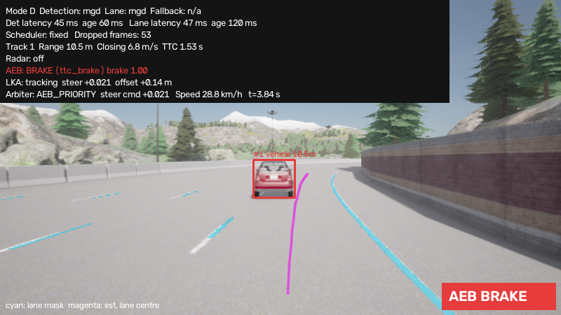
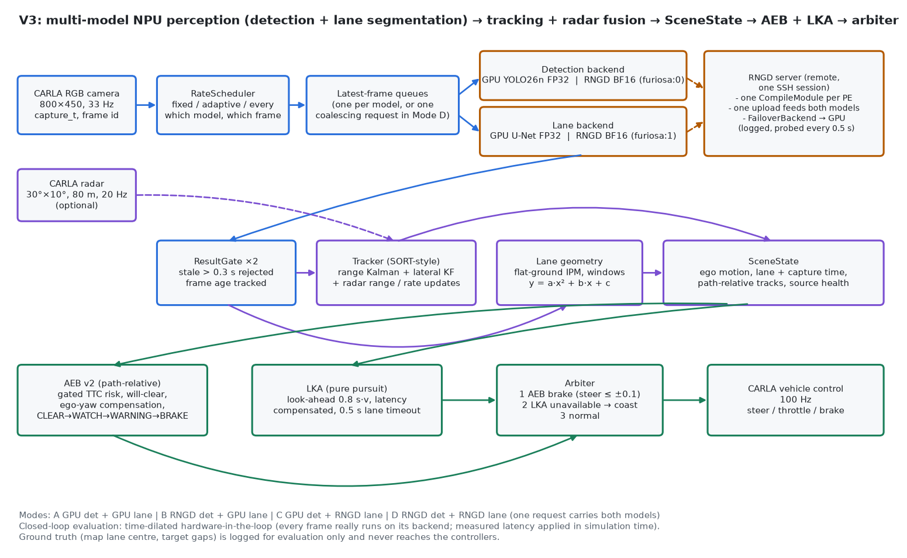
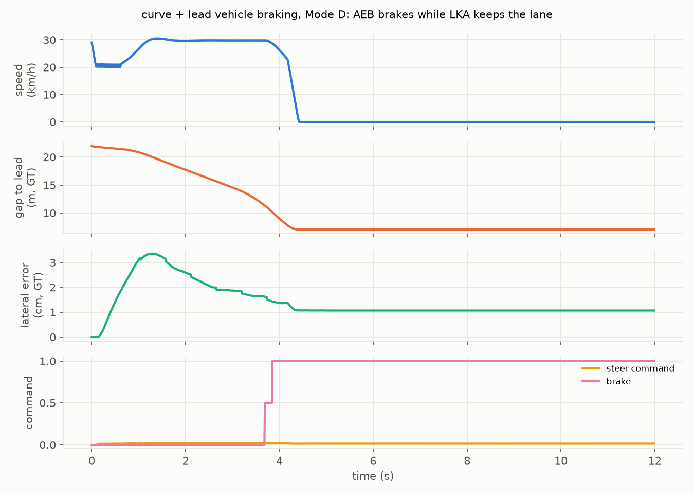

# Edge-NPU 기반 자율주행 인지·제어 시스템

> **GPU와 Furiosa RNGD NPU를 실제 CARLA 주행 루프에 연결하고, 모델 포팅부터 비동기 런타임·AEB·LKA·장애 분석까지 검증한 Mobility AI 프로젝트입니다.**

[English keywords: Edge AI · NPU Systems · Autonomous Driving · Computer Vision · Closed-loop Evaluation]

## 프로젝트 소개 (Overview)

이 프로젝트는 단순히 NPU에서 모델을 실행하는 데서 끝나지 않습니다. 객체 탐지와 차선 분할 모델을
실제 Furiosa RNGD NPU에 포팅하고, 그 결과를 CARLA 차량 제어에 연결해 **인지 → 판단 → 제어가
이어지는 폐루프(closed loop)**를 구현했습니다.

카메라 영상은 객체 탐지(Object Detection)와 차선 분할(Lane Segmentation)에 사용됩니다. 인지 결과는
추적(Tracking), 자동 긴급 제동(AEB), 차선 유지 보조(LKA)로 전달됩니다. 평가에서는 모델 추론 시간만
비교하지 않고, 네트워크 전송과 큐 대기를 포함한 **전체 시스템 지연이 실제 제동 거리와 차선 유지에
어떤 영향을 주는지** 측정했습니다.

| 구분 | 내용 |
|---|---|
| **담당 범위** | NPU 모델 포팅, 비동기 추론 런타임, CARLA 인지·제어 통합, 실험 설계, 장애 원인 분석 |
| **핵심 기술** | Python, PyTorch, CARLA, Furiosa RNGD, CUDA, Computer Vision, AEB, LKA |
| **개발 환경** | Windows 11, RTX 3060 12 GB, CARLA 0.9.16, 원격 Linux NPU 호스트 |
| **검증 방식** | 80회 폐루프 주행, GPU/NPU 동일 프레임 비교, fault injection, SHA-256 evidence manifest |

> **주의:** 이 저장소는 시뮬레이션 기반 연구 프로토타입입니다. 실제 차량용 제품이 아니며 실시간성이나
> 기능 안전(Functional Safety)을 보장하지 않습니다. 시험 시나리오에서 충돌이 없었다는 결과가 일반적인
> 안전성을 의미하지 않습니다. 모든 수치는 `reports/evidence/`의 실행 기록을 기반으로 하며 SHA-256
> manifest는 `reports/v1/`, `reports/v2/`, `reports/v3/`에 있습니다.

| 버전 | 주요 목표 | 결과 보고서 |
|---|---|---|
| **V1** `v1.0.0-rc1` | CARLA GPU 폐루프 AEB + YOLO26n 실제 NPU 검증 | [`reports/v1_final_report.md`](reports/v1_final_report.md) |
| **V2** `v2.0.0-rc1` | 프레임 나이 기반 비동기 런타임, 추적·Kalman Filter, 강건한 AEB | [`reports/v2_final_report.md`](reports/v2_final_report.md) |
| **V3** `v3.0.0-rc1` | 다중 모델 NPU 인지, 차선 분할, LKA, AEB+LKA 중재, Radar Fusion | [`reports/v3_final_report.md`](reports/v3_final_report.md) |

## 핵심 성과 (Key Results)

이 프로젝트에서는 지연 시간을 다음 세 가지로 분리해 해석했습니다.

- **모델 지연(Model latency):** 가속기에서 한 프레임을 계산하는 시간
- **요청 왕복 지연(End-to-end request latency):** 전송과 원격 처리를 포함한 클라이언트 왕복 시간
- **데이터 나이(Data age):** 제어기가 인지 결과를 사용할 때 해당 결과가 얼마나 오래되었는지 나타내는 값

| 성과 | 측정 결과 | 분류 | 근거 |
|---|---|---|---|
| RNGD YOLO26n, BF16 | 배치 1 평균 **2.0 ms**, GPU FP32 대비 recall 0.972 / precision 0.992 | 모델 지연 | `npu_bench_bf16.json`, `gpu_vs_npu_bf16.json` |
| RTX 3060 공정 비교 | CUDA Graph 2.60 ms, eager 13.54 ms. 겉보기 6배 차이가 공정 비교에서는 1.2–1.4배로 감소 | 모델 지연 | `gpu_benchmark_ext.json` |
| RNGD Lane U-Net, BF16 | **2.8 ms**, 동일 입력에서 GPU FP32 대비 IoU 0.991–0.998 | 지연·정확성 | `v3_npu_multimodel_bench.json`, `v3_lane_correctness_*.json` |
| YOLO26n Multi-PE 확장 | 1 / 2 / 4 PE에서 537 → 1,052 → **1,762 inference/s**(3.3배), 8 PE부터 호스트 병목 | 처리량 | `v2_npu_multistream2.json` |
| 다중 모델 NPU 서버 | 한 번의 업로드로 탐지 `furiosa:0` + 차선 `furiosa:1` 실행: 탐지만 55 ms, 두 모델 61 ms | 원격 E2E | `v3_npu_multimodel_bench.json` |
| 원격 전송 최적화 | 단계별 프로파일링으로 평균 왕복 지연 **203 → 60 ms**, 탐지 결과 손실 없음 | 원격 E2E | `v2_transport_profile*.json` |
| CARLA 원격 NPU 폐루프 | 2–3 ms 연산이 요청당 63–65 ms, 탐지 데이터 나이 p95 **121–126 ms**로 증가. 로컬 GPU는 30 ms | E2E·Data age | `v3_closed_loop.json` |
| 연산자 호환성 DB | 컴파일러 실제 메시지를 포함한 74개 compile/run 결과 기록 | 모델 포팅 | `docs/npu_operator_compatibility.md` |
| V3 폐루프 평가 | **80회 주행**, 위험 시나리오 **36회·충돌 0회**, 정상 세션 차선 이탈 0회 | 시뮬레이션 | `v3_closed_loop*.json` |
| 차선 데이터 지연 한계 | +150 ms까지 LKA 유지, +250 ms에서는 57–65% 구간 사용 불가. 한계 약 0.25초 | Data age | `v3_closed_loop.json` |
| GPU Failover | NPU stall → GPU 0.54초, crash → GPU 0.11초, 오프라인 프레임 손실 0 | 강건성 | `v3_failure_engineering.json` |

**실패하거나 안전하지 않았던 결과도 숨기지 않고 기록했습니다.**

- **50 km/h 곡선 + 선행차 제동:** 원격 NPU 데이터 노후화로 최소 제동 여유가 GPU 13.7 m에서 2.1 m로 감소
- **Stale detection:** RNGD 지연에 20% stale 결과를 주입했을 때 보행자 앞 0.33 m에서 정지
- **Radar fusion:** 세 종류 시나리오 중 두 종류에서 접근 속도 추정이 오히려 악화
- **반경 39 m 급곡선:** 위험물이 없는데도 10회 중 4회 불필요한 제동 발생
- **INT8:** 연산 속도 향상 없음

자세한 내용은 [실패 분석](#failure-analysis)에 정리했습니다.

## 주행 데모 (Demo)

Mode D에서는 객체 탐지와 차선 분할을 모두 RNGD에서 실행하며, 조향은 카메라 기반 차선 인지만 사용합니다.

| 곡선 AEB 제동 + 차선 중심 추정 | 코너링 중 보행자 AEB 경고 | RNGD 서버 crash → GPU failover |
|---|---|---|
|  |  |  |

**V3 영상:** [`assets/demo/v3/demo_v3.mp4`](assets/demo/v3/demo_v3.mp4)
640×360, 5.5 MB이며 곡선+보행자, 곡선+선행차 제동, NPU crash failover 세 장면으로 구성됩니다.

영상 오버레이에는 다음 정보가 표시됩니다.

- 객체 탐지 box와 차선 mask
- 모델별 실행 backend
- 모델 지연과 frame age
- 추적 거리, 접근 속도, TTC
- AEB·LKA·중재기(arbiter) 상태
- 조향값과 차량 속도

야간·우천 문제는 재현 장면을 연출하지 않고 실제 실패 기록을 [실패 분석](#failure-analysis)에 남겼습니다.

**이전 버전 영상**

- V1: [GPU AEB](assets/demo/v1_demo.mp4)
- V2: [NPU 실시간 루프](assets/demo/v2_demo_npu_live.mp4), [Failover](assets/demo/v2_demo_npu_failover.mp4)

## 시스템 구조 (Architecture)



| 모드 | 객체 탐지 | 차선 분할 |
|---|---|---|
| A | GPU | GPU |
| B | RNGD | GPU |
| C | GPU | RNGD |
| D | RNGD | RNGD — 한 요청에서 서로 다른 PE로 두 모델 실행 |

**런타임 핵심 구성**

- 최신 프레임만 유지하는 queue
- 0.3초가 지난 결과를 차단하는 stale-result gate
- 전환 원인을 명시적으로 기록하는 GPU failover
- AEB와 LKA의 유일한 입력으로 사용하는 `SceneState`

모든 프레임은 지정된 backend에서 실제로 실행됩니다. 측정된 지연을 시뮬레이션 시간에 반영하는
**시간 확장 Hardware-in-the-loop 평가**를 사용했습니다.

이전 구조: [V1](assets/diagrams/v1_architecture.png), [V2](assets/diagrams/v2_architecture.png)

## 프로젝트 발전 과정 (Project Evolution)

### V1 — GPU 폐루프와 NPU 검증

- **폐루프 구현:** CARLA camera → GPU YOLO26n → 단안 거리·TTC → AEB
- **결과:** 30 km/h 위험 시나리오 30회에서 camera-only AEB 충돌 0회
- **NPU 배포:** YOLO26n을 RNGD FP32/BF16/W8로 실행하고 GPU와 프레임 단위 비교
- **의사결정 일치:** AEB replay 7회 모두 GPU와 NPU의 최초 제동 시점 일치
- **공정한 기준선:** CUDA Graph 적용 후 겉보기 6배 NPU 우위가 1.2–1.4배로 감소
- **발견한 문제:** 단안 접근 속도 노이즈, 40–50 km/h 보행자 충돌, 약 120 ms SSH 전송 지연

### V2 — 비동기 NPU 런타임과 강건한 AEB

- 단계별 프로파일링으로 원격 RNGD 경로를 **203 → 60 ms**로 단축
- `InferenceBackend` 추상화(GPU/RNGD/replay), latest-frame queue, frame-age gate, 명시적 failover 구현
- SORT 계열 tracker, 거리 Kalman Filter, 경로 예측 기반 AEB 상태 머신 구현
- 위험 시나리오 충돌 0/18회(V1 2/18회, AEB off 14/18회)
- 0–200 ms 인지 지연 주입 범위에서 충돌 없음
- 원격 RNGD의 실제 CARLA 루프 동작을 확인했지만 frame age p95 165–212 ms로 준실시간 수준

### V3 — 다중 모델 NPU 인지, LKA, Sensor Fusion

- 측정한 컴파일러 한계에 맞춰 Lane Segmentation Network 설계
- 2개 PE를 사용하는 다중 모델 NPU 서버와 Mode D request coalescing 구현
- 카메라 기반 LKA(pure pursuit + 지연 보상), AEB+LKA 중재 구현
- 1단계 sensor fusion으로 camera+radar 결합
- Fault injection, 폐루프 failover, memory guard 기반 평가 수행
- 총 80회 폐루프 평가 결과를 [평가](#evaluation)에 정리

## NPU 엔지니어링 (NPU Engineering)

### 모델 포팅

| 모델 | 용도 | NPU 결과 | 정밀도 | 주요 문제 | 해결 방법 |
|---|---|---|---|---|---|
| YOLO26n | 주행 객체 탐지 | PASS, 2.0 ms | BF16, FP32, W8 | 미융합 BatchNorm import 실패, head concat lowering | Conv+BN 융합, raw head에서 분할 후 host decode/NMS |
| Lane U-Net, 2.12 M params | 차선 분할 | PASS, 2.8 ms | BF16 | ConvTranspose·bilinear·dilated conv 미지원, 256×512 pooling 실패 | ConvT → 1×1 conv+PixelShuffle, bilinear → nearest+filter, 3×3 stride-2 |
| YOLO26s | 대형 탐지 모델 | FAIL → PASS, 4.67 ms | BF16 | lowering된 weight slice가 64 KiB를 초과 | output-channel SplitConv 후 CPU 원본과 동일성 검증 |
| Tiny ViT | 소형 Transformer | PASS, 0.44–0.48 ms | BF16 | SDPA의 q/k/v contiguous 요구 | attention 전 `.contiguous()` 적용 |
| MobileNetV3-Small | 분류 | PASS, 0.50 ms | BF16 | 없음 | 없음 |
| ResNet18 | 분류 backbone | **FAIL** | BF16 | 512→512, 512→256 conv의 64 KiB 한계 | input-channel split + 결과 합산 필요 |
| LR-ASPP MobileNetV3 | 분할 후보 | **FAIL** | BF16 | rewrite 후 backend scheduling 오류 | 추가 진행하지 않고 U-Net으로 대체 |

모델별 근거: [`docs/npu_model_portfolio.md`](docs/npu_model_portfolio.md)

### 연산자 호환성과 Graph Rewrite

- 컴파일러 메시지를 포함한 74개 compile/run 결과:
  [`docs/npu_operator_compatibility.md`](docs/npu_operator_compatibility.md)
- CPU 원본 연산과 동일성을 검증한 6개 rewrite:
  BN folding, bilinear ×2, ConvTranspose, dilated conv, split conv, contiguous attention
- 실패 유형 분석: [`docs/npu_graph_lowering_notes.md`](docs/npu_graph_lowering_notes.md)

### 정밀도와 양자화 (Precision / Quantization)

- 배포 정밀도는 **BF16**입니다.
  - 동일 입력에서 BF16 차선 mask는 FP32와 IoU 0.991–0.998
  - RNGD 출력은 GPU BF16과 일치
- **W8은 weight-only 방식**입니다.
  - weight 저장 공간 4.82 MB → 2.44 MB
  - 속도는 오히려 2.00 ms → 2.35 ms로 감소
  - recall 0.972 → 0.957
- **실제 INT8 연산(W8A8)**은 `furiosa-torch 2026.4.0`에서 불가능했습니다.
  - int8 convolution이 modulo 256으로 wrap
  - int32 누산 convolution 미지원
  - activation quantization 미지원

세부 내용: [`docs/quantization_limitations.md`](docs/quantization_limitations.md)

### 다중 모델 스케줄링

- 모델별로 PE를 분리하면 stress 상황에서도 객체 탐지 400 Hz 유지
- 한 PE에 worker 2개를 배치하면 순차 실행보다 느리고, strict priority는 차선 모델 starvation 발생
- Mode D dispatcher가 탐지·차선 요청을 한 upload로 병합
- request aliasing으로 차선 모델이 굶는 버그를 발견해 수정
- 폐루프에서는 전송 지연이 지배적이어서 전략별 주행 결과 차이는 작음
- adaptive priority로 dropped frame 170 → 21, queue delay 15 → 3 ms 감소

### 런타임 Failover

- 상태: PRIMARY / FALLBACK / DEGRADED, 모든 전환을 log로 기록
- 오프라인: RNGD stall → GPU 0.54초, crash → GPU 0.11초, 프레임 손실 0
- CARLA: stall 후 RNGD로 복귀했지만 server crash 후 12초 주행 안에는 복귀하지 못함
- failed NPU wait를 fallback latency에서 누락하던 계산 버그를 V3에서 발견해 수정

### 원격 전송 병목

- NPU 연산은 2–3 ms지만 공유 원격 호스트까지 SSH 왕복은 60 ms 이상
- 단계별 프로파일링으로 203 → 60 ms까지 무손실 최적화
  - letterbox 유효 영역만 전송
  - 원격 thread pinning
  - 정확한 pre-filter 적용
  - SSH compression 사용
- JPEG은 약 30 ms까지 줄지만 recall이 0.89–0.91로 감소해 사용하지 않음
- 공유 호스트의 memory pressure로 request timeout이 발생하며 야간·우천 실패로 이어짐

## 자율주행 인지·제어 (Autonomous Driving)

### 객체 탐지

- YOLO26n, 640×640 letterbox 입력
- GPU와 RNGD 모두 동일한 host decode/NMS를 사용해 동일 조건 비교
- box 하단과 평면 도로 기하로 단안 거리 추정 후 tracker에서 거리·접근 속도 filtering

### 차선 분할

- RNGD 컴파일러 제약에 맞춘 U-Net을 CARLA 데이터로 학습
- 미사용 map Town03에서 IoU 0.727(GPU FP32)
- 150개 held-out frame: GPU FP32 0.688, 배포 RNGD 경로 0.664
- 차이의 대부분은 BF16이 아니라 NPU client의 이중 resize에서 발생
- mask를 지면에 투영한 뒤 2차 경계선으로 fitting해 횡방향 오차·heading·curvature 계산

세부 설계: [`docs/v3_perception_control.md`](docs/v3_perception_control.md)

### 추적과 거리 추정

- SORT 계열 tracker + 거리 Kalman Filter + lateral filter
- yaw rate를 이용한 ego-motion 보상
- 접근 속도 MAE를 오프라인 기준 1.51 → 1.27 m/s로 감소

근거: [`docs/v2_tracking.md`](docs/v2_tracking.md),
[`docs/v2_range_rate_filtering.md`](docs/v2_range_rate_filtering.md)

### Radar Fusion

- 카메라가 생성한 track만 CARLA 전방 radar로 보정
- NIS gate를 적용한 scalar Kalman update 사용
- radar 단독으로 track을 생성하지 않음
- 결과는 시나리오에 따라 개선과 악화가 혼재

### 자동 긴급 제동 (AEB)

- 곡선에서도 차선 내 장애물을 놓치지 않도록 path-relative corridor 기반 WARNING/BRAKE 상태 머신 구현
- `SceneState`의 추적 거리와 접근 속도로 TTC와 gap 계산

### 차선 유지 보조 (LKA)

- Pure pursuit 사용: look-ahead = 0.8초 × 차량 속도
- odometry로 차선 데이터 age 보상
- 차선 정보가 0.5초를 넘으면 stale geometry로 조향하지 않고 LKA를 unavailable 상태로 전환
- 제동 우선 중재: AEB 작동 중 throttle은 0, steering은 ±0.1로 제한
- 회피 조향은 구현하지 않음

<a id="evaluation"></a>

## 평가 (Evaluation)

V3에서는 CARLA 0.9.16과 시간 확장 HIL 방식으로 총 **80회 폐루프 주행**을 수행했습니다.

- 차선 유지 24회: Mode A–D × 6개 route
- 집중 평가 50회: 곡선 AEB+LKA, radar 비교, scheduling, fault, lane-age sweep
- 재실행 6회: 정상 memory 상태의 야간·우천, simulator 수정 후 stale injection

전체 표: [`reports/v3_closed_loop_tables.md`](reports/v3_closed_loop_tables.md)

**30 km/h 차선 유지 결과**
Map lane center 대비 lateral RMSE이며 정상 세션에서 차선 이탈은 0회입니다.

| 주행 경로 | A: GPU lane | C/D: RNGD lane |
|---|---|---|
| 직선 / 완만한 곡선(R 147 m) | 0.8 / 1.4 cm | 0.9–1.0 / 1.9–2.3 cm |
| 급곡선(R 39 m) / 미사용 Town03 | 9.7 / 5.3 cm | 11–13 / 5.3–5.5 cm |
| 야간 / 우천 | 1.6 / 1.6 cm | 2.5–2.6 / 2.0–2.3 cm(정상 세션 재실행) |

**위험 시나리오와 AEB+LKA 동시 동작**

- 전체 backend와 fault 조건을 포함한 위험 시나리오 36회, 충돌 0회
- 곡선 시나리오 16회에서 충돌 0회·차선 이탈 0회
- 제동 중 횡방향 오차 12 cm 이하
- 29,618개 제동 tick 모두 AEB 우선 상태, `|steer| ≤ 0.10`
- 50 km/h 보행자: GPU 탐지 최소 gap 3.44 m, 두 모델 RNGD 최소 gap 2.11 m

| 검증 질문 | 측정 결과 |
|---|---|
| NPU 차선 분할이 폐루프에서 동작하는가? | 정상 세션에서는 동작했습니다. 원격 요청이 실패하고 lane fallback이 없을 때는 동작하지 못했습니다. |
| 다중 모델 NPU가 data age를 증가시키는가? | 탐지 age p95는 원격 121–126 ms, GPU 30 ms이며 두 번째 모델 추가 비용은 약 6 ms입니다. |
| Radar가 접근 속도를 개선하는가? | 50 km/h 선행차는 개선(0.40 → 0.24 m/s, gap 5.5 → 10.4 m)했지만 보행자와 곡선 장애물에서는 악화됐습니다. |
| AEB 중 LKA가 안정적인가? | 제동 중 횡방향 오차 12 cm 이하, steering 0.10 이하, 차선 이탈 0회였습니다. |
| 제어 지연 예산을 만족하는가? | 차선은 약 0.25초까지 가능하지만 50 km/h 제동 여유는 최대 11.6 m 감소했습니다. |




<a id="failure-analysis"></a>

## 실패 분석 (Failure Analysis)

### INT8 연산 한계

- W8은 weight-only 방식으로 저장 공간만 4.82 → 2.44 MB로 감소
- 모든 multiply-accumulate는 여전히 BF16에서 실행
- W8은 BF16보다 느림(2.35 vs 2.00 ms), recall 0.972 → 0.957
- 실제 INT8 연산은 시험한 SDK에서 불가능
  - int8 convolution modulo 256 wrap
  - int32 누산 convolution 미지원
  - activation quantization 미지원

추측이 아니라 compiler probe로 확인한 결과이며, 실패 결과도 근거로 보존했습니다.

### 원격 전송 지연

- 모델은 빠르지만 시스템은 빠르지 않았습니다. NPU 추론은 2–3 ms지만 원격 왕복 시간이 지배적입니다.
- 단계별 profiling으로 과도한 payload, thread oversubscription, decode 비용을 찾아 203 → 60 ms로 단축했습니다.
- 폐루프 탐지 data age p95는 원격 121–126 ms, GPU 30 ms입니다.
- 근본적인 해결책은 더 빠른 모델이 아니라 NPU를 카메라 가까이에 배치하는 것입니다.

### 야간·우천 NPU 차선 이탈 사고

1. **증상:** RNGD lane Mode C/D가 야간·우천에서 차선을 이탈했습니다. 처음에는 어두운 저대비
   프레임에서 BF16 정밀도가 떨어진 것으로 보였습니다.
2. **가설 검증:** dataset 240개와 실제 주행 200개, 총 440개 동일 프레임을 GPU와 NPU에서 비교했습니다.
   - RNGD는 GPU BF16과 일치했고 FP32 대비 IoU는 0.991–0.998이었습니다.
   - 야간·우천 결과는 주간보다 나쁘지 않았습니다.

   따라서 **BF16 정밀도 문제라는 가설은 기각했습니다.**
3. **근본 원인:** 실패한 4개 주행은 호스트 memory가 부족해지기 직전 마지막 실행이었습니다.
   탐지와 차선 요청이 모두 1초 timeout에 걸렸고, Mode C/D에는 lane fallback이 없어 LKA 입력이 사라졌습니다.
4. **재검증:** memory가 정상인 상태에서 같은 설정을 다시 실행하자 차선 이탈 0회,
   RMSE 2.0–2.6 cm를 기록했습니다.
5. **별도 결함:** NPU client가 letterbox 640×360 후 512×256으로 다시 resize합니다.
   이중 resize로 mask IoU가 2–6% 감소하고 우천 offset 오차가 약 2 cm 증가합니다.


### 남아 있는 위험과 미해결 문제

- 50 km/h 곡선 선행차 제동에서 최소 gap이 GPU 13.7 m, RNGD+RNGD 2.1 m
- RNGD 지연 + 20% stale 탐지에서 횡단 보행자 앞 0.33 m 정지
- Radar fusion이 30 km/h 보행자와 곡선 장애물 접근 속도 추정을 악화
- 반경 39 m 무위험 곡선에서 10회 중 4회 불필요한 제동
- Mode C/D는 기본 GPU lane fallback이 없음
- 의심스러운 수치를 재검토해 발견하고 unit test와 함께 수정한 버그:
  - Mode D lane-request aliasing
  - failed wait를 누락한 failover latency
  - measured-latency simulation이 stale injection을 지우던 문제

## 한계 (Known Limitations)

- 원격 RNGD 폐루프는 준실시간이며 SSH 전송이 병목
- Mode C/D에 기본 lane fallback 없음
- Radar fusion이 모든 시나리오에서 개선되지 않음
- 급곡선 불필요 제동과 반경 39 m 차선 geometry offset 0.30 m 문제
- ResNet18과 LR-ASPP 컴파일 실패, 실제 INT8 연산 미지원
- 평가 범위:
  - 조건별 1회 실행이라 confidence interval 없음
  - 개발과 평가가 같은 scenario family에 속함
  - 50 km/h LKA 미평가
  - LiDAR·traffic light 미지원
  - CARLA 시뮬레이션만 수행, 실제 차량 미검증
- 16 GB RAM에서 CARLA와 도구를 함께 실행하기 빠듯해 memory guard와 단계별 matrix 실행 사용

## 저장소 구조 (Repository Structure)

```text
src/npu_ad/
  perception/   YOLO raw head, Lane U-Net·geometry, tracker, filter, radar fusion
  runtime/      GPU/RNGD/replay backend, async pipeline, multi-model client, failover
  control/      AEB(V1/V2), LKA, arbiter
  simulation/   CARLA session·sensor, server lock, geometry, traffic actor
  npu/          RNGD compiler용 exact graph rewrite
  evaluation/   평가 지표
  viz/          데모 overlay
  scene.py      AEB와 LKA의 유일한 입력인 SceneState
remote/         NPU 호스트에서 실행하는 compile·benchmark·server·probe
scripts/        실험, matrix 실행, 분석, 데모, diagram·manifest 생성
tests/          pytest suite, fake NPU server, 선택적 live CARLA test
configs/        scenario·latency·route 설정
code/           CARLA 단계별 학습 코드 01–09
docs/           설계 문서, NPU 포팅, 면접 질문, 이력서 요약
reports/        V1–V3 최종 보고서, evidence JSON, manifest, 표, sanitization 기록
assets/         데모 영상·프레임, plot, architecture diagram
```

## 실행 방법 (Reproduction)

### 로컬 CARLA / GPU

**필요 환경**

- Windows 11
- Python 3.12
- NVIDIA GPU, 개발 환경은 RTX 3060 12 GB
- CARLA 0.9.16과 Python wheel
- `requirements-lock-windows.txt`에 고정된 package

모델 weight(`models/*.pt`), dataset, local output은 저장소에 포함하지 않습니다.

```powershell
python -m venv .venv
.\.venv\Scripts\pip install -r requirements-lock-windows.txt

$env:PYTHONPATH = "src;scripts"
.\.venv\Scripts\python.exe -m pytest -q
# models/yolo26n.pt가 있으면 80 passed, 1 skipped
# 없으면 79 passed, 2 skipped

<CARLA_ROOT>\CarlaUE4.exe -RenderOffScreen -carla-rpc-port=2000
$env:NPU_AD_LIVE_CARLA = "1"
.\.venv\Scripts\python.exe -m pytest -q

.\.venv\Scripts\python.exe scripts\run_v1_demo.py
.\.venv\Scripts\python.exe scripts\v3_analyze.py
```

### Furiosa RNGD NPU

**필요 환경**

- Furiosa RNGD hardware 접근 권한
- Linux 호스트의 Furiosa SDK, 시험 버전은 `furiosa-torch 2026.4.0`

NPU 호스트는 공유 원격 장비를 사용했습니다. SSH alias로 접속하며 실제 hostname, user, key는
저장소에 포함하지 않습니다.

```text
Host furiosa-npu
    HostName <REMOTE_NPU_HOST>
    User <REMOTE_USER>
```

```powershell
.\.venv\Scripts\python.exe scripts\npu_remote.py sync
.\.venv\Scripts\python.exe scripts\run_v3_demo.py
bash scripts/v3_matrix_focused.sh lk_strong comb_a comb_b
.\.venv\Scripts\python.exe scripts\v3_lane_correctness.py
```

V1·V2의 상세 재현 절차는 각 버전 최종 보고서에 있습니다.

## 다음 개선 과제 (Future Work)

1. **NPU 로컬 배치:** zero-copy capture와 C++ client를 적용해 detection age 40 ms 이하 달성
2. **차선 failover 기본 적용:** RNGD lane mode에 GPU fallback을 넣고 이중 resize 제거
3. **AEB target logging:** 급곡선 경로 예측과 radar association 문제의 원인 추적
4. **추가 모델 포팅:** input-channel split 기반 ResNet18, SDK 지원 후 activation quantization
5. **평가 확대:** 반복 실험과 confidence interval, held-out scenario, 50 km/h LKA, LiDAR fusion

---

이 프로젝트는 높은 성능 수치만 보여주는 대신, **실패를 재현하고 가설을 반증한 뒤 시스템 수준의
원인을 찾는 과정**을 함께 기록했습니다. 특히 “NPU 모델 지연이 빠르면 자율주행 제어도 빨라진다”는
단순한 가정을 실제 폐루프 실험으로 검증하고, 전송 지연·데이터 나이·fallback 설계가 안전성에 미치는
영향을 수치로 확인했습니다.
