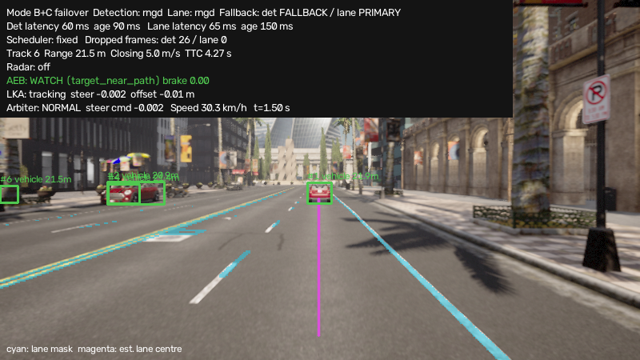

# Edge-NPU Autonomous Driving Perception & Control System

I ported several perception models to a real NPU (Furiosa RNGD), built a multi-model runtime for them,
measured where accelerator and transport time goes, and closed the loop in CARLA. A camera drives
object detection and lane segmentation, which feed tracking, emergency braking (AEB) and lane keeping
(LKA). The evaluation then measures how perception freshness affects braking margins and lane keeping.

> Simulation-only research prototype. Not production autonomous driving, no real-time guarantee, no
> functional-safety process. Every number below comes from a recorded run in `reports/evidence/` (SHA-256
> manifests in `reports/v1/`, `reports/v2/`, `reports/v3/`).

| Version | Focus | Report |
|---|---|---|
| **V1** `v1.0.0-rc1` | GPU closed-loop AEB in CARLA + real-NPU validation of YOLO26n (offline) | [`reports/v1_final_report.md`](reports/v1_final_report.md) |
| **V2** `v2.0.0-rc1` | async frame-age-aware runtime, tracking + Kalman, robust AEB, remote NPU in the live loop | [`reports/v2_final_report.md`](reports/v2_final_report.md) |
| **V3** `v3.0.0-rc1` | multi-model NPU perception, lane segmentation, LKA, AEB + LKA arbitration, radar fusion | [`reports/v3_final_report.md`](reports/v3_final_report.md) |

## Key Results
**NPU deployment:**
- **YOLO26n BF16:** 2.0 ms on RNGD; recall 0.974 against GPU FP32.
- **Lane U-Net:** redesigned around measured compiler limits; 2.8 ms; RNGD output equals GPU BF16
  (IoU 0.991–0.998 against FP32 on the same input).
- **YOLO26s:** compiles after an exact split-conv rewrite (4.67 ms).
- **Operator database:** 74 recorded compile/run results.
- **Two models on two PEs** from one upload: 61 ms vs 55 ms for detection alone, remote.
- **Multi-PE scaling:** 1,762 inferences/s on 4 PEs.

**System latency:**
- **Remote NPU path:** 203 → 60 ms, lossless, found by stage profiling.
- **Inside the loop:** 2–3 ms of NPU compute becomes 63–65 ms per request (mean) and 121–126 ms of
  detection age (p95), vs 30 ms with the local GPU.

**Closed loop** (CARLA; 74 runs plus 6 reruns in V3):
- **Hazard scenarios:** 36, 0 collisions.
- **Healthy-session runs:** 0 lane departures.
- **Camera-only LKA at 30 km/h:** lateral RMSE 0.8–1.4 cm on straight and mild curves, 10–13 cm on a
  39 m-radius curve.
- **Lane-age limit:** LKA tolerates up to about 0.25 s, beyond which it becomes unavailable.

**What does not work** (kept as evidence; details in [Failure Analysis](#failure-analysis)):
- **Shrinking margin:** remote NPU staleness cuts the 50 km/h curve braking margin from 13.7 m to 2.1 m.
- **Stale results:** 20 % stale detections left 0.33 m to a pedestrian.
- **Radar fusion** is mixed.
- **Sharp curve:** it triggers unneeded braking.

## System Architecture


**Backend modes:**

| Mode | Detection | Lane |
|---|---|---|
| A | GPU | GPU |
| B | RNGD | GPU |
| C | GPU | RNGD |
| D | RNGD | RNGD (one request carries both models; detection on `furiosa:0`, lane on `furiosa:1`) |

**Runtime:**
- latest-frame queues
- stale-result gates (0.3 s)
- explicit, logged GPU failover
- a `SceneState` that is the only input to AEB and LKA

**Evaluation is time-dilated hardware-in-the-loop.** Every frame really runs on its backend, and the
measured latency is applied in simulation time. Earlier architectures:
[V1](assets/diagrams/v1_architecture.png), [V2](assets/diagrams/v2_architecture.png).

## Demo
Mode D: both models on the RNGD, steering only from camera lane perception.

| Lane mask + estimated centre, AEB braking on a curve | Pedestrian while cornering (AEB warning) | RNGD server crash → GPU failover (logged) |
|---|---|---|
|  |  |  |

**Video:** [`assets/demo/v3/demo_v3.mp4`](assets/demo/v3/demo_v3.mp4). It has three clips (curve +
pedestrian, curve + lead braking, NPU crash failover), 640×360, real-time playback; the summary is in
`demo_v3_summary.json`.

**What the overlay shows:**
- detection and lane backend
- per-model latency and frame age
- dropped frames
- track range, closing speed and TTC
- radar status
- AEB, LKA and arbiter states
- steering and speed

Unavailable values are printed as `n/a`.

**Clip choice:** the demo uses representative day scenarios. The night/rain failure of the RNGD lane modes
is analysed separately below rather than hidden or staged.

**Earlier demos:** [V1](assets/demo/v1_demo.mp4) (GPU AEB) and V2
([NPU live loop](assets/demo/v2_demo_npu_live.mp4), [failover](assets/demo/v2_demo_npu_failover.mp4)).

## V1 — GPU Closed Loop + NPU Validation
- **Closed loop:** CARLA camera → YOLO26n on GPU → monocular range / TTC → AEB.
- **Camera-only AEB:** 0 collisions in 30 hazard runs at 30 km/h.
- **NPU validation:** YOLO26n deployed on RNGD and validated offline frame by frame. In a replay of 738
  identical frames, the NPU made the same braking decision as the GPU.
- **Fair baseline:** CUDA Graphs reduced the apparent "NPU 6× faster" to 1.2–1.4×.

**Exposed:**
- noisy monocular closing speed
- collisions with pedestrians at 40–50 km/h
- 121 ms SSH frame transport

## V2 — Async NPU Runtime + Robust AEB
- **Transport:** stage profiling cut the remote RNGD path from 203 to 60 ms, losslessly.
- **Runtime:**
  - InferenceBackend abstraction (GPU / RNGD / replay)
  - latest-frame queue
  - frame-age gate
  - explicit failover
- **Perception:** a SORT-style tracker with a range Kalman filter, plus a path-prediction AEB state
  machine.
- **Braking results:**
  - hazard collisions 0 / 18 (V1: 2 / 18, AEB off: 14 / 18)
  - collision-free with 0–200 ms injected perception latency
- **Remote RNGD in the live CARLA loop:** works, but near-real-time (age p95 165–212 ms).

## V3 — Multi-Model NPU Perception + LKA + Sensor Fusion
**Lane keeping at 30 km/h** (lateral RMSE vs the map lane centre; 0 departures in healthy runs):

| Route | A GPU lane | C / D RNGD lane |
|---|---|---|
| straight / mild curve (R 147 m) | 0.8 / 1.4 cm | 0.9–1.0 / 1.9–2.3 cm |
| sharp curve (R 39 m) / held-out Town03 | 9.7 / 5.3 cm | 11–13 / 5.3–5.5 cm |
| night / rain | 1.6 / 1.6 cm | 2.5–2.6 / 2.0–2.3 cm (healthy rerun) |

**AEB + LKA together:**
- **Curve scenarios (16 runs, all modes):** 0 collisions and 0 departures. Lateral error while braking
  stays at or below 12 cm.
- **Arbitration:** in all 29,618 logged braking ticks, the arbiter was in an AEB mode and |steer| was at
  most 0.10. Throttle is 0 while braking by construction (`Arbiter`, unit-tested); throttle is not logged.


**Freshness by backend:**


## NPU Engineering
### Model Porting
| Model | Compile | Runtime | Main issue → workaround |
|---|---|---|---|
| YOLO26n | PASS | 2.0 ms BF16 | unfused BN, head concat → fuse + split at the raw head |
| Lane U-Net | PASS | 2.8 ms BF16 | ConvT / bilinear / dilated unsupported, pooling fails at 256×512 → exact rewrites + 3×3 s2 downsampling |
| YOLO26s | FAIL → PASS | 4.67 ms | 64 KiB weight-slice limit → exact output-channel SplitConv |
| MobileNetV3-S / tiny ViT | PASS | 0.50 / 0.44 ms | SDPA needs contiguous q/k/v |
| ResNet18, LR-ASPP | FAIL | — | input-channel slice limit; backend scheduling error (open) |

Full table: [`docs/npu_model_portfolio.md`](docs/npu_model_portfolio.md).

### Operator Compatibility
- **Compile results:** 74 generated rows with the compiler's messages:
  [`docs/npu_operator_compatibility.md`](docs/npu_operator_compatibility.md).
- **Failure classes:** [`docs/npu_graph_lowering_notes.md`](docs/npu_graph_lowering_notes.md).

### Precision / Quantization
- **BF16:** the deployed precision. RNGD masks are identical to GPU BF16; BF16 costs < 1 % mask IoU.
- **W8:** weight-only, and slower than BF16.
- **True INT8 compute and activation quantization:** unavailable on `furiosa-torch` 2026.4.0. Shown by
  compiler probes: [`docs/quantization_limitations.md`](docs/quantization_limitations.md).

### Multi-PE Scaling
- **Scaling:** 537 → 1,052 → 1,762 inferences/s on 1 / 2 / 4 PEs.
- **Ceiling:** 8 PEs reach only 947/s because the host becomes the bottleneck (Python threads).

### Scheduling
- **Offline:** separate PEs per model are best; two workers on one PE are worse than sequential.
- **In the loop:** transport dominates, so all strategies give the same outcome. Adaptive priority cuts
  dropped frames (170 → 21) and queue delay (15 → 3 ms).

### Runtime Failover
- **Offline:** RNGD stall → GPU in 0.54 s, crash → GPU in 0.11 s, 0 frames lost.
- **In CARLA:** stall and crash were handled, and every switch was logged. After a stall it went back to
  RNGD; after a crash it did not, within the 12 s run.
- **Latency accounting:** the fallback latency includes the failed wait.

## CARLA Evaluation
**V3 runs:**
- **Main matrix:** 74 runs. The first 24 are lane keeping (A–D × 6 routes); the other 50 come from a
  focused matrix (`scripts/v3_matrix_focused.sh`).
- **Separate reruns:** 6.
- **Test types:** lane keeping, combined curve scenarios, radar pairs, scheduling, faults and a lane-age
  sweep.

The design is justified in the V3 report §11. Every table is in
[`reports/v3_closed_loop_tables.md`](reports/v3_closed_loop_tables.md).

| Question | Answer (measured) |
|---|---|
| Does NPU lane segmentation work in closed loop? | Yes, in healthy sessions. With failing remote requests and no lane fallback, it did not. |
| Does multi-model NPU scheduling raise frame age? | Remote: detection age p95 121–126 ms vs 30 ms (GPU); the second model adds about 6 ms |
| Best scheduling strategy? | Separate PEs, with adaptive priority (same outcome, fewest drops) |
| Does radar improve closing speed? | Lead vehicle at 50 km/h: yes (0.40 → 0.24 m/s, gap 5.5 → 10.4 m). Pedestrian at 30 km/h and curve obstacle: worse |
| Pedestrian at 50 km/h vs V2 | 3.44 m gap (GPU), V2 2.27 m; 2.11 m with both models on RNGD |
| LKA stable during AEB? | Yes: max lateral error while braking ≤ 12 cm, steering ≤ 0.10, no departures |
| Practical control budget met? | Lane: yes (limit about 0.25 s). Braking at 50 km/h: margin drops by up to 11.6 m |


## Failure Analysis
1. **The night/rain "NPU lane failure" was a runtime failure, not a numerical one.**
   - **What happened:** the four failing C/D runs were the last before the system stopped CARLA for low
     memory. Their RNGD requests (detection too) timed out at 1 s.
   - **Healthy rerun:** the same configurations had 0 departures.
   - **Same frames, side by side:** RNGD equals GPU BF16. The NPU client's double resize costs 2–6 % IoU.
   - **Real lesson:** RNGD lane modes need a lane fallback.

   
2. **Remote staleness costs braking margin.** On a curve with lead braking at 50 km/h, the gap is
   13.7 m with the GPU vs 2.1 m with RNGD + RNGD.
3. **Stale detections are dangerous.** With 20 % stale results and RNGD latency (Mode B), the car stopped
   0.33 m from a crossing pedestrian. This was found only after fixing a simulation bug that had silently
   disabled stale injection.
4. **Radar fusion stage 1 is mixed.** Its closing-speed error is worse for a pedestrian and on a curve.
   The likely cause is radar association with other surfaces; this is not isolated.
5. **Unneeded braking on a 39 m-radius curve** (4 of 10 runs), and early braking for a kerbside
   pedestrian. The cause is path extrapolation on tight curves.
6. **Bugs found by checking suspicious numbers:**
   - Mode D lane-request aliasing (fixed)
   - failover latency hiding the failed wait (fixed)
   - stale injection erased by measured-latency simulation (fixed)

   Each has a unit test and an entry in `reports/agent_runs/failures.jsonl`.

## Reproduction
```powershell
$env:PYTHONPATH = "src;scripts"
.\.venv\Scripts\python.exe -m pytest -q          # 80 passed, 1 skipped (live CARLA test is opt-in)
$env:NPU_AD_LIVE_CARLA = "1"; .\.venv\Scripts\python.exe -m pytest -q   # with a CARLA server running

C:\CARLA_0.9.16\CarlaUE4.exe -RenderOffScreen -carla-rpc-port=2000   # separately; one client at a time
.\.venv\Scripts\python.exe scripts\run_v1_demo.py                     # V1 demo (GPU)
.\.venv\Scripts\python.exe scripts\run_v3_demo.py                     # V3 demo (needs RNGD access)
bash scripts/v3_matrix_focused.sh lk_strong comb_a comb_b              # V3 phases (see the script)
.\.venv\Scripts\python.exe scripts\v3_lane_correctness.py              # same-frame GPU vs RNGD lane test
.\.venv\Scripts\python.exe scripts\v3_analyze.py                       # tables + plots from evidence
```
- **RNGD access** goes through an existing `~/.ssh/config` alias, `furiosa-npu`. Host, user and key are
  not in the repository.
- **Not committed:** model weights (`models/*.pt`, SHA-256 in the reports), datasets, replay frames,
  compiler caches, local logs (`outputs/`).
- **Earlier reproduction steps:** in the V1 and V2 reports.

## Known Limitations
- **Near-real-time:** the remote RNGD loop is near-real-time, not real-time. Co-locating the NPU with the
  camera is the fix; SSH transport is the bottleneck.
- **No lane fallback by default:** Modes C/D have none; only the failover configuration has one.
- **Open perception/control issues:**
  - radar fusion is not a general improvement
  - unneeded braking on tight curves
  - a lane-geometry offset error of 0.30 m on a 39 m-radius curve
- **Porting gaps:**
  - ResNet18 and LR-ASPP do not compile
  - no INT8 compute
- **Evaluation scope:**
  - one run per cell, so no confidence intervals
  - developed and evaluated on the same scenario family
  - no lane keeping at 50 km/h
  - no LiDAR and no traffic-light model
  - CARLA only
- **Resources:** 16 GB RAM is tight for CARLA plus the tooling. The matrix was stopped twice by memory
  pressure; it now runs in phases with a free-RAM guard.

## Roadmap
1. Co-located NPU runtime: zero-copy capture, C++ client, no SSH. Target detection age below 40 ms.
2. Lane failover by default for RNGD lane modes; same preprocessing on both paths (remove the double
   resize).
3. Log the AEB target state; fix tight-curve path extrapolation and radar association.
4. ResNet18 via an input-channel split; activation quantization once the SDK supports it.
5. Repeated runs with confidence intervals, held-out scenarios, lane keeping at 50 km/h, LiDAR stage 2.
