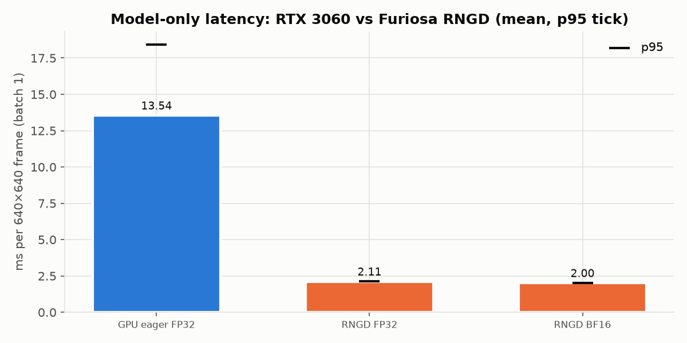
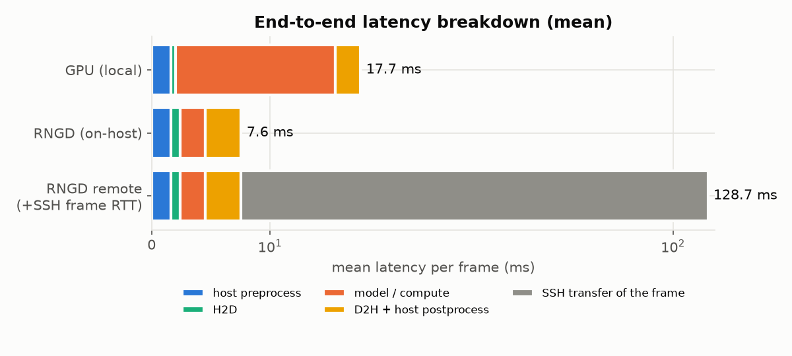
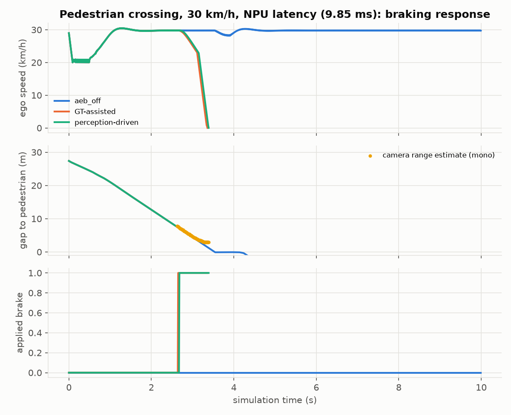

# NPU Auto Driving Project 2 — CARLA → YOLO26n → GPU / Furiosa RNGD → AEB

Personal research prototype (simulation only, not a road-ready system). A camera-perception and
emergency-braking pipeline in CARLA 0.9.16 whose detector is deployed both on an RTX 3060 and on a
**Furiosa RNGD** NPU, with closed-loop AEB experiments that separate ground-truth-assisted from truly
perception-driven braking.

Every number below comes from a recorded run in `reports/evidence/`. Status labels:
**TESTED** (executed with evidence) · **PARTIAL** · **BLOCKED** (external limitation) · **NOT_RUN**.

## Engineering problem
Can a YOLO-class detector be moved from a desktop GPU to a datacenter NPU without changing its
behaviour, and what does that mean for a safety function (AEB) whose margin depends on perception
latency and on how distance is obtained?

## Results at a glance (measured 2026-11-22/23)

| Area | Result | Status |
|---|---|---|
| CARLA pipeline | sync mode, frame-matched sensor queue; 3/3 × 100-frame captures, 0 orphaned actors; exclusive server lock | TESTED |
| Deployment unit | fused YOLO26n split at the raw head; matches the unfused original on 72/72 frames (348/348 detections) | TESTED |
| Model-only latency, batch 1 | GPU eager 13.54 ms · **GPU CUDA Graph 2.60 ms** · **RNGD FP32 2.11 ms** · RNGD BF16 1.85–2.00 ms | TESTED |
| Latency stability (std) | GPU CUDA Graph 0.18 ms · RNGD FP32 0.007 ms | TESTED |
| Board energy per frame | GPU CUDA Graph ≈ 351 mJ (136 W) · RNGD FP32 ≈ 113 mJ (53 W) — different meters | TESTED (indicative) |
| NPU vs GPU detections (54 held-out frames) | FP32 recall 0.988 / precision 0.992 · BF16 0.972 / 0.992 | TESTED (agreement, not mAP) |
| NPU vs GPU in the AEB chain (open-loop replay, 738 identical frames) | identical first-brake decision in 7/7 runs | TESTED |
| INT8 compute (W8A8) | int8 conv wraps modulo 256; int32 accumulation and `_int_mm` do not compile | BLOCKED (SDK 2026.4.0) |
| INT8 weight-only (W8, BF16 compute) | weights −49 % vs BF16, **no speed-up** (2.16–2.35 ms), recall 0.957 | TESTED (negative result) |
| Remote NPU transport (desktop ↔ RNGD host) | 121 ms per raw 640×640 frame over SSH (≈ 10 MB/s) | TESTED → remote NPU-in-the-loop not real-time |
| Closed-loop AEB, 30 km/h, 0–200 ms delay | AEB off: every hazard collides · GT-assisted 0/30 · **perception-driven 0/30** collisions · 0 false brakes in 45 no-hazard runs | TESTED (simulation) |
| Perception-only range | MAE 0.11 m (pedestrian) – 0.79 m (vehicle at 15–40 m); closing-speed MAE 1.2–3.2 m/s | TESTED |
| Speed sweep | pedestrian crossing at 40 km/h collides in all modes; at 50 km/h AEB *causes* a side collision (controller defect) | TESTED (documented failure) |
| NPU-in-the-loop driving, GT mAP | not done | NOT_RUN |

**The NPU-vs-GPU ratio is not a hardware verdict.** Against eager PyTorch the RNGD looks 6× faster;
against CUDA Graphs on the same GPU it is 1.2–1.4× faster at batch 1, far more stable and ~3× more
energy-efficient. See `docs/gpu_npu_comparison.md`.




## Architecture

```text
 CARLA 0.9.16 (sync, dt 0.01 s)        desktop (Windows, RTX 3060)                       remote RNGD host
 ┌──────────────────────┐  BGRA   ┌──────────────────────────────────────────┐
 │ ego + RGB camera     │─frame──▶│ letterbox 640² (shared code)             │──frames──▶ furiosa:0
 │ targets, collision   │         │  ├ CUDA: fused YoloRaw (raw head)        │  (offline, CompileModule
 └─────────▲────────────┘         │  └ decode + NMS on host (shared)         │◀─raw out──  fp32/bf16/w8)
           │                      │ AEB input: gt_oracle | gt_gated | mono   │
           │ VehicleControl       │ mono = ground-plane range + CIPO tracker │
           └──────────────────────│ DelayLine = measured latency             │
                                  └──────────────────────────────────────────┘
```
Details, module boundaries and failure handling: `docs/architecture.md`.

## Technology stack
Python 3.12 · PyTorch 2.14 (CUDA 12.6) · ultralytics 8.4 (YOLO26n) · CARLA 0.9.16 · Furiosa SDK
`furiosa-torch` 2026.4.0 (RNGD firmware 2026.4.0) · matplotlib · pytest · ruff.
Exact desktop environment: `requirements-lock-windows.txt`.

## GPU → NPU deployment workflow
Fuse Conv+BN → split at the raw detection head (static 1×3×640×640, decode/NMS on host) → freeze the
exact letterboxed inputs → AOT compile with `furiosa.torch.CompileModule` → run on `furiosa:0` with
stream-synchronised timing → apply the identical host decode → compare. `docs/npu_compilation.md`.

## Experimental methodology (short)
- Same frames, same preprocessing and postprocessing code for both accelerators; GPU benchmarks run
  with the CARLA server stopped (it shares the GPU; contention measured separately: +58 %).
- Latency is reported as model-only, device-side incl. transfers, transport, and the end-to-end p95
  used as control delay — kept as separate quantities.
- AEB: three input modes (GT oracle / GT-assisted / perception-driven), 8 scenarios incl. night, rain
  and no-hazard probes, 7 latency conditions, 4 speeds; ground truth logged for evaluation only.
- Integrity: atomic resumable result files; runs that overlapped an unauthorized CARLA client were
  quarantined and re-run (1 of 6 actually differed); repeatability checked.

## Known limitations
Simulation only (one map, one seed per cell, single target); 100 Hz perception with latency modelled
as actuation delay; no ground-truth labels → detection *agreement* instead of mAP; NPU not in the
closed loop (remote transport 121 ms); NPU batch > 1 not compiled; shared RNGD host (timings vary
≤ 0.2 ms, compile times depend on load); flat-ground range assumption; AEB controller has no
"target will clear" logic. Full list: `docs/aeb_evaluation.md`, `docs/quantization_limitations.md`.

## Reproduce
Windows desktop (GPU, CARLA) and the remote RNGD host are set up separately.

```powershell
# Desktop: existing venv (Python 3.12, torch 2.14.1+cu126, carla 0.9.16 wheel, ultralytics 8.4.202)
cd <LOCAL_PROJECT_ROOT>
$env:PYTHONPATH = "src"
.\.venv\Scripts\python.exe -m pytest -q          # unit tests; live CARLA tests only with $env:NPU_AD_LIVE_CARLA="1"

# CARLA server (separate terminal). One client at a time: CarlaSession holds outputs/locks/carla_*.lock
C:\CARLA_0.9.16\CarlaUE4.exe -RenderOffScreen -carla-rpc-port=2000

# Phase 1-2: capture, dataset, raw-split validation, GPU baselines (stop CARLA for benchmarks)
.\.venv\Scripts\python.exe scripts\capture_smoke.py --runs 3 --frames 100
.\.venv\Scripts\python.exe scripts\collect_dataset.py
.\.venv\Scripts\python.exe scripts\validate_raw_split.py --all --device cpu --out reports\evidence\raw_split_validation_all_cpu.json
.\.venv\Scripts\python.exe scripts\gpu_benchmark.py --tag fp32_clean --export-npu-inputs
.\.venv\Scripts\python.exe scripts\gpu_benchmark_ext.py

# Phase 3-5: RNGD host through an existing ~/.ssh/config alias "furiosa-npu" (one job at a time)
.\.venv\Scripts\python.exe scripts\npu_remote.py sync
.\.venv\Scripts\python.exe scripts\npu_remote.py put outputs\npu\inputs.pt
.\.venv\Scripts\python.exe scripts\npu_remote.py start -- compile --dtype fp32     # also bf16, w8
.\.venv\Scripts\python.exe scripts\npu_remote.py start -- bench --dtype fp32
.\.venv\Scripts\python.exe scripts\npu_remote.py start -- perf --dtype fp32
.\.venv\Scripts\python.exe scripts\npu_remote.py start int8_probe
.\.venv\Scripts\python.exe scripts\npu_remote.py fetch npu_outputs_fp32.pt outputs\npu
.\.venv\Scripts\python.exe scripts\compare_gpu_npu.py --dtype fp32
.\.venv\Scripts\python.exe scripts\measure_link.py
.\.venv\Scripts\python.exe scripts\model_size.py

# Phase 6: closed-loop scenarios (CARLA running), then reports
.\.venv\Scripts\python.exe scripts\make_latency_conditions.py
bash scripts/run_v3_matrix.sh ; bash scripts/run_v3_followup.sh
.\.venv\Scripts\python.exe scripts\replay_aeb.py prepare   # then upload, bench --inputs replay_inputs.pt --tag _replay
.\.venv\Scripts\python.exe scripts\replay_aeb.py gpu ; .\.venv\Scripts\python.exe scripts\replay_aeb.py replay
.\.venv\Scripts\python.exe scripts\render_v3_tables.py ; .\.venv\Scripts\python.exe scripts\make_plots.py
```
Weights (`models/yolo26n.pt`, SHA-256 `9b09cc8bf347f0fc8a5f7657480587f25db09b34bf33b0652110fb03a8ad4fef`),
datasets and raw outputs (`outputs/`) are not committed.

## Demo evidence
Plots in `assets/plots/` (all generated from evidence files by `scripts/make_plots.py`), detection
visualisations in `assets/vis_*.jpg`. No video recording was made.




## Documentation
| File | Content |
|---|---|
| `docs/architecture.md` | data flow, modules, timing model, failure handling |
| `docs/npu_compilation.md` | GPU → RNGD deployment workflow and per-variant results |
| `docs/quantization_limitations.md` | INT8 investigation, W8 weight-only, BF16 verdict |
| `docs/gpu_npu_comparison.md` | latency layers, throughput, power, transport, replay, verdict |
| `docs/aeb_evaluation.md` | three AEB baselines, matrix, speed sweep, failures, integrity |
| `docs/troubleshooting.md` | every observed problem with cause and fix |
| `docs/portfolio_summary_en.md`, `docs/portfolio_summary_ko.md` | short portfolio summaries |
| `reports/technical_audit.md` | Phase 1 independent review (Codex, Kiro, author) and dispositions |
| `reports/final_report.md` | phase status table, approvals, next steps |
| `reports/agent_runs/latest_status.md` | handoff |

## Future work
GT-labelled CARLA set for mAP; co-located NPU or compressed transport for a real NPU-in-the-loop;
NPU batch > 1 and multi-device; AEB path prediction and a "target will clear" rule (fixes the 50 km/h
failure); range-rate filtering (Kalman) for the perception-driven mode; multiple seeds/maps;
TensorRT comparison (needs approval to install).
