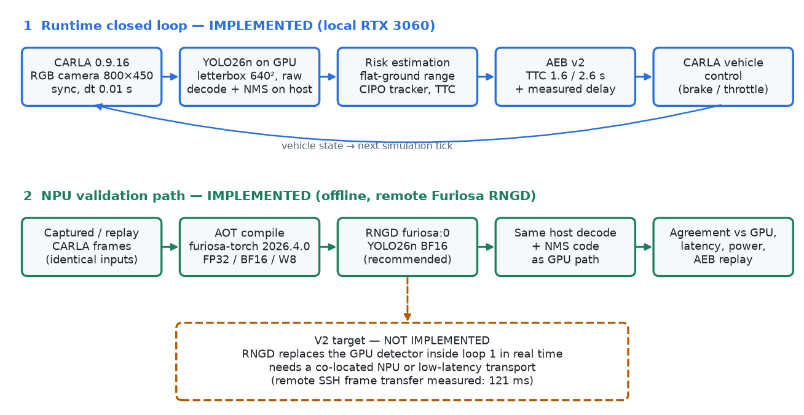
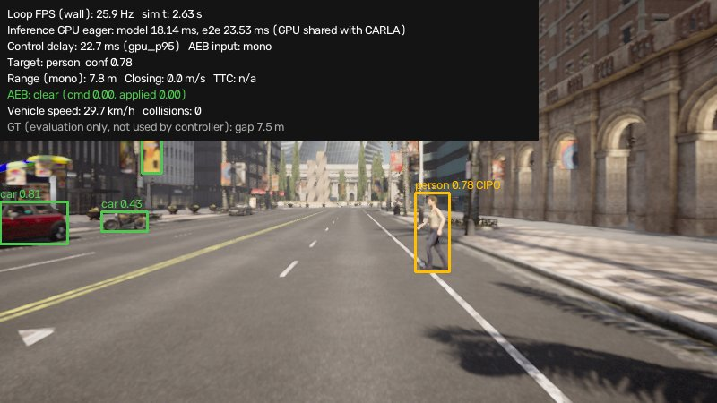
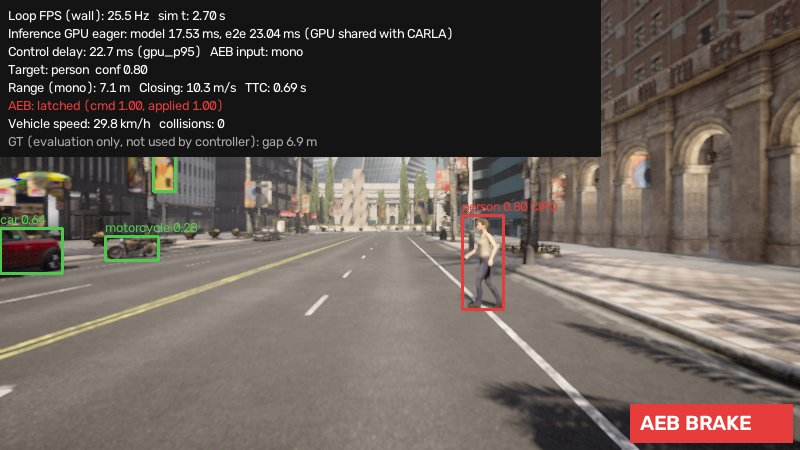
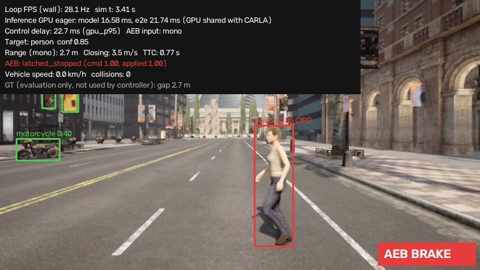
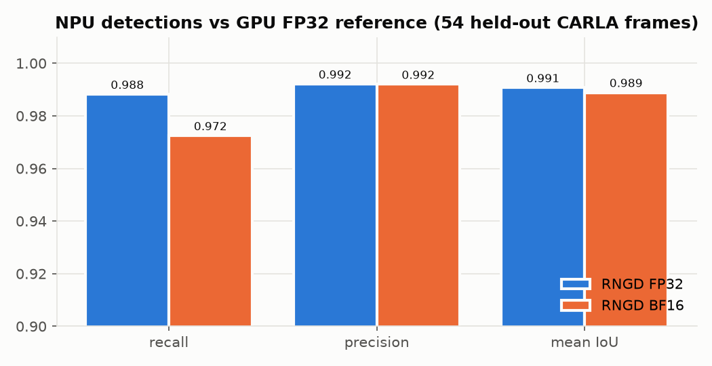
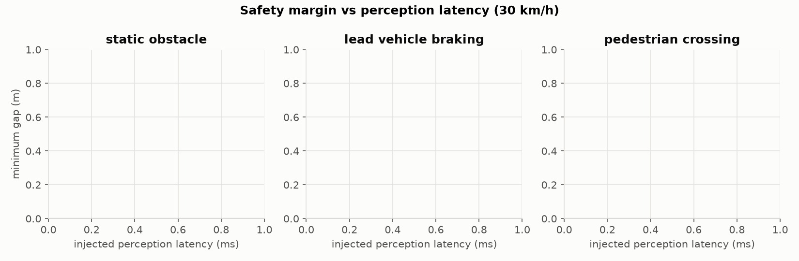
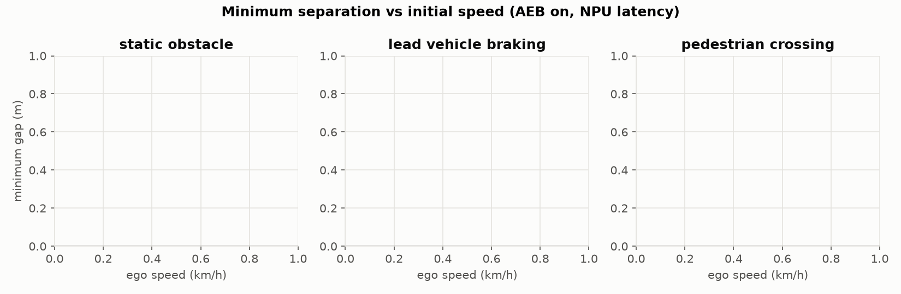
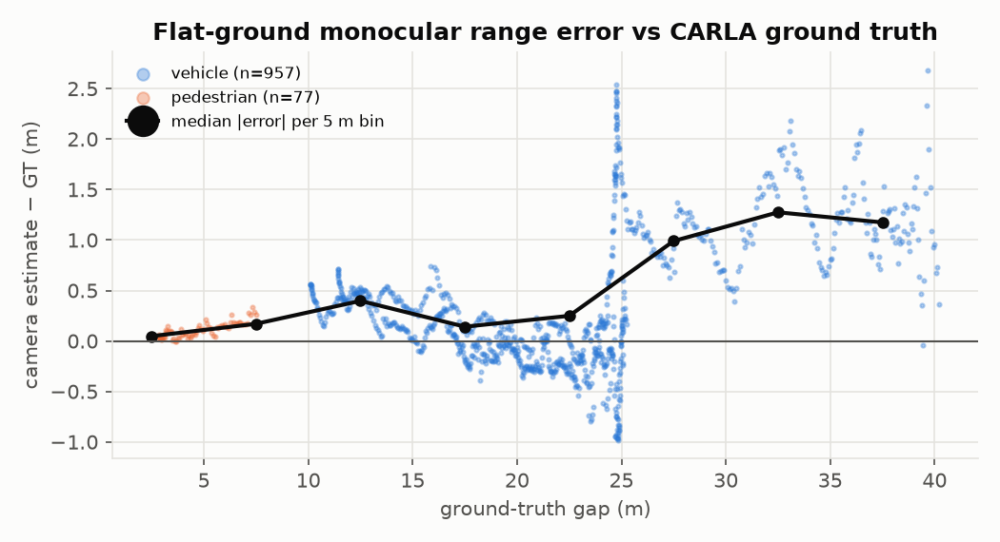

# CARLA-NPU Autonomous Driving Perception System

**Portfolio V1 (v1.0.0-rc1)**: a personal research prototype that runs only in simulation and is not
production-ready autonomous driving. I built a camera-to-brake AEB loop in CARLA. I also deployed
the same YOLO detector on a Furiosa RNGD NPU to see how an edge NPU changes inference latency and the
system design.

Every number on this page comes from a recorded run. Each one can be traced through
`reports/evidence/`, and `reports/v1/evidence_manifest.json` lists SHA-256 hashes for them. The full
V1 report is `reports/v1_final_report.md`.

## Overview
| What V1 has | Status |
|---|---|
| Closed loop: CARLA camera → **YOLO26n on GPU** → monocular range / TTC → AEB → CARLA vehicle control | **Implemented and tested** |
| NPU deployment: YOLO26n → `furiosa-torch` AOT compile → **BF16** inference on a real RNGD → agreement and latency benchmark | **Implemented and tested (offline)** |
| Live remote NPU inside the CARLA closed loop | **Not implemented** (V2 target; transport measured at 121 ms per frame) |

The NPU is **not** in the real-time driving loop. It was validated offline on the same frames that the
GPU loop sees. In an open-loop replay of 738 identical frames, it gave the same first-brake decision
as the GPU in 7 of 7 runs.

## Problem
Two questions drive the project:

1. **Can a camera-only AEB brake in time?** It has to work from 2D detections, without ground-truth
   distance.
2. **What happens when the detector moves from a desktop GPU to an NPU?** I wanted to know whether
   its outputs stay the same, and how much latency, power and integration cost change.

## System Architecture


The diagram has two separate paths:
- **Path 1, runtime closed loop (implemented).** Every 10 ms simulation tick runs the full chain
  (camera frame → GPU YOLO → range and TTC → AEB → vehicle control).
- **Path 2, NPU validation (implemented, offline).** It uses the exact letterboxed frames and the same
  decode/NMS code as Path 1, so the two outputs can be compared one to one.

The dashed box is the V2 target. Module boundaries and failure handling are described in
`docs/architecture.md`.

## Demo
```powershell
# terminal 1: CARLA server (started separately)
C:\CARLA_0.9.16\CarlaUE4.exe -RenderOffScreen -carla-rpc-port=2000
# terminal 2: one command runs the whole demo
.\.venv\Scripts\python.exe scripts\run_v1_demo.py
```

**What the demo does:**
- It runs `pedestrian_crossing` at 30 km/h with the camera-only AEB input (`mono`) and the measured
  GPU p95 latency (22.7 ms) as actuation delay.
- It executes the same `run_scenarios.run` code path as the evaluation matrix, plus a read-only
  overlay.
- Output goes to `outputs/v1/demo/`: an MP4, key frames, a per-tick JSONL log and `summary.json`.

**Recorded result** (`reports/v1/demo_summary.json`; two consecutive runs gave the same outcome):
- No collision; the minimum gap was 2.68 m. The matrix cell for the same configuration also gives
  2.68 m.
- The AEB commanded braking at t = 2.67 s and the brake was applied at 2.70 s. At the first applied
  brake, the ground-truth gap was 6.9 m (GT TTC 0.83 s).
- Monocular range error was 0.10 m MAE (p95 0.26 m, n = 79).

| Pedestrian tracked, AEB clear | AEB braking (applied) | Stopped 2.7 m before the pedestrian |
|---|---|---|
|  |  |  |

Video: [`assets/demo/v1_demo.mp4`](assets/demo/v1_demo.mp4) (3.4 s of simulated time, real-time
playback).

**Overlay contents:**
- loop rate
- GPU inference time
- control delay
- target class and confidence
- monocular range, closing speed and TTC
- AEB state (commanded and applied)
- vehicle speed

A separate grey line shows the ground-truth gap. It is for evaluation only; the controller never sees
it. Values that are not available are printed as `n/a`.

The overlay shows the estimator's real behaviour, including its weaknesses:
- **Closing speed starts at 0.0 m/s.** The tracker needs 5 range samples before it reports a closing
  speed.
- **Closing speed is noisy.** In the screenshot it reads 10.3 m/s, while the ego drives 8.3 m/s.
- **The loop is not real-time.** It runs at about 25 Hz of wall-clock time for a 100 Hz simulation.

## Technology Stack
| Layer | Desktop (closed loop, GPU benchmark) | Remote RNGD host (NPU) |
|---|---|---|
| Hardware | RTX 3060 12 GB, Ryzen 5 5600, Windows 11 | Furiosa RNGD (`npu0`, firmware 2026.4.0), shared host |
| Runtime | Python 3.12.10, PyTorch 2.14.1+cu126, CUDA 12.6, cuDNN 9.10.2, driver 616.92 | Python 3.11.18, torch 2.10.0+cpu, `furiosa-torch` 2026.4.0 (rev 5800e2ba24) |
| Model | YOLO26n (`ultralytics` 8.4.202), weights SHA-256 `9b09cc8b…fef` | same weights, fused and split at the raw head |
| Simulator | CARLA 0.9.16, Town10HD_Opt, synchronous mode, dt 0.01 s, TM seed 42 | — |
| Tools | OpenCV 5.0, matplotlib, pytest, ruff | `furiosa-smi` |

Pinned desktop environment: `requirements-lock-windows.txt`.

## CARLA Perception Pipeline
**1. Camera.** An 800×450 RGB camera, FOV 90°, mounted 1.5 m forward and 1.7 m high. A frame-matched
queue only accepts the image whose `frame` equals the value returned by `world.tick()`.

**2. Preprocessing.** Letterbox to 640×640 (pad value 114), BGR → RGB, CHW float32 in [0, 1].

**3. Model.** The fused YOLO26n is split at the raw detection head: box and score tensors only, with a
static shape of 1×3×640×640. The same deployment unit runs on CUDA and on `furiosa:0`.

**4. Postprocessing on the host.** It is shared by GPU and NPU:
- DFL decode and sigmoid
- NMS (`conf 0.25`, `IoU 0.7`, `max_det 300`; this checkpoint is not end-to-end)
- rescale to image pixels

I validated the split model against the unfused original on 72/72 frames (348/348 detections, max
decoded difference 0.017).

**5. Range.** Monocular flat-ground range uses Z = f<sub>y</sub>·h<sub>cam</sub> / (v<sub>bottom</sub> − c<sub>y</sub>).
Camera height is calibrated at rest, after a 1 s settle phase. Box size is never used as distance.

**6. CIPO tracker.** It selects the closest in-path object (corridor ±1.8 m). Closing speed comes from
a least-squares fit over 0.3 s of range history. Fits with a residual above 0.5 m are rejected.

## AEB Controller
The AEB v2 thresholds are:
- full brake at TTC ≤ 1.6 s or a gap below 4 m
- partial brake (0.5) at TTC ≤ 2.6 s
- a 3-tick hold on perception and hysteresis
- a latch at standstill

The measured perception latency is applied as an actuation delay (`DelayLine`, quantised to 10 ms
ticks). Three input modes are kept strictly apart:

| Mode | Range / TTC source | Label |
|---|---|---|
| `gt_oracle` | CARLA ground truth, camera ignored | GT oracle (upper bound) |
| `gt_gated` | CARLA ground truth, brakes only while YOLO confirms the target | GT-assisted |
| `mono` | **camera only** (range + tracker above); GT logged for scoring only | **perception-driven** |

## GPU Baseline
The GPU benchmark runs with the CARLA server stopped. CARLA shares the GPU, and contention slows the
detector by 58 %.

I kept two GPU modes:
- **Eager PyTorch.** This is what the closed loop runs.
- **CUDA Graphs.** This is the optimised baseline. Its outputs are bit-identical to eager (max abs
  diff 0.0).

Eager PyTorch at batch 1 is launch-bound. Comparing the NPU only against eager would overstate the NPU
by about 6×, so the **CUDA Graph numbers are the GPU reference** in the table below.

Batch sweep (eager): batch 8 reaches 2.45 ms per frame (408 fps). A cold first inference takes 388 ms.
Details: `docs/gpu_npu_comparison.md`.

## Furiosa NPU Deployment
The deployment has six steps:
1. Fuse Conv+BN.
2. Split the model at the raw head.
3. Freeze the exact letterboxed inputs.
4. AOT compile with `furiosa.torch.CompileModule` (`implicit_type_casting`, `lowering_mode Optimal`,
   `num_pe 8`).
5. Run on `furiosa:0`, timed with stream synchronisation.
6. Apply the identical host decode and NMS, then compare against the GPU frame by frame.

**Precisions:**
- **BF16 is the V1 precision.** It is the fastest variant and agrees closely with the GPU (recall
  0.972, precision 0.992).
- **W8 (weight-only INT8) is an optimisation experiment, not INT8 inference.** Weights are stored as
  per-channel int8 and dequantised to BF16 inside the graph, so compute stays BF16. Results:
  - It needs 49 % less weight storage than BF16 (2.44 MB vs 4.82 MB).
  - It is not faster.
  - Its agreement with the GPU is lower (recall 0.957, precision 0.980).
- **True INT8 compute (W8A8) is blocked by the SDK.** A compiler probe on `furiosa-torch` 2026.4.0
  showed three failures:
  - int8 convolution compiles, but accumulates with modulo-256 wrap-around on 100 % of outputs
  - int32-accumulating convolution fails with `O117 not yet supported`
  - `aten::_int_mm` cannot be imported

Compile times were 1162–1902 s on the shared host.

Docs: `docs/npu_compilation.md`, `docs/quantization_limitations.md`.

## GPU vs NPU Benchmark
Batch 1, model-only (inputs prepared, accelerator time with synchronisation), same 72 CARLA frames.
Agreement is measured against GPU FP32 detections on 54 held-out frames; it is not mAP.

| Path | Precision | n | mean (ms) | p95 (ms) | p99 (ms) | Throughput (fps) | Agreement recall / precision | Board power |
|---|---|---|---|---|---|---|---|---|
| GPU eager (PyTorch) | FP32 | 360 | 13.54 | 18.43 | 25.19 | 72 | reference | 52.3 W |
| **GPU CUDA Graph** | FP32 | 300 | **2.60** | 3.01 | 3.23 | 387 | identical to eager | 135.8 W |
| RNGD | FP32 | 216 | 2.107 | 2.119 | 2.125 | 470 | 0.988 / 0.992 | 53.3 W |
| **RNGD (V1)** | **BF16** | 216 | **2.000** | 2.020 | 2.071 | 543 | 0.972 / 0.992 | 53.6 W |
| RNGD | W8 weight-only (BF16 compute) | 216 | 2.352 | 2.371 | 2.682 | 446 | 0.957 / 0.980 | 51.2 W |

How the table was measured:
- **Latency source.** RNGD latency uses the `bench` protocol, which copies each frame to the device and
  synchronises the stream.
- **Second RNGD protocol.** The `perf` protocol keeps inputs resident on the device and runs n = 500,
  giving FP32 2.149 / BF16 1.854 / W8 2.155 ms.
- **Throughput source.** Throughput is a 20 s sustained run with a synchronise after every frame. The
  GPU CUDA Graph figure comes from the power run.
- **Stability.** RNGD std is 0.007 ms (FP32); GPU CUDA Graph std is 0.18 ms.
- **Idle power.** RNGD idle power is 39 W. The GPU idle reading had not settled and is not used.

> **The power comparison is indicative only.** GPU power is read through NVML at 50 ms sampling, and
> RNGD power through `furiosa-smi` at 1 W resolution and ~0.7 s sampling. Both are whole-board
> figures that include static power. Dividing power by fps gives roughly 113 mJ per frame (RNGD FP32)
> vs 351 mJ (GPU CUDA Graph). That ratio rests on two different meters and is not a controlled
> efficiency measurement.

**Takeaways:**
- **Speed at batch 1.** Against the optimised GPU baseline, the RNGD is 1.2–1.4× faster per frame and
  much more stable.
- **Batch effect.** The GPU at batch 8 reaches a similar per-frame time.
- **Transport.** Frame transport from this desktop to the remote RNGD costs 121.2 ms (mean) /
  124.8 ms (p95) per 1.23 MB frame. That is about 60× the inference time.




## Closed-loop Evaluation
**Setup:** v3 matrix, 30 km/h, CARLA Town10HD_Opt.
- Scenarios:
  - Hazards: stationary vehicle, lead vehicle braking, pedestrian crossing, plus a night variant and
    a rain variant.
  - No-hazard probes: empty road, vehicle in the adjacent lane, pedestrian at the roadside.
- Latency conditions: 0 / 9.85 (NPU on-vehicle p95) / 22.7 (GPU p95) / 100 / 134.7 (NPU remote p95) /
  200 ms.

Data: `reports/evidence/scenarios_v3.json`. Counts were recomputed in `reports/v1/aeb_summary.json`.

| Mode | Hazard runs | Collisions | No-hazard runs | False brake events | Min gap: worst / median | Median GT TTC at first brake |
|---|---|---|---|---|---|---|
| AEB off | 5 | **5** | 3 | 0 | contact (−0.10 m) | — |
| GT oracle | 25 ¹ | 0 | 15 | 0 | 1.52 / 9.04 m | 2.28 s |
| GT-assisted | 30 | 0 | 15 | 0 | 1.52 / 9.04 m | 2.16 s |
| **Perception-driven (camera only)** | **30** | **0** | **15** | **0** | **1.12 / 9.37 m** | 2.39 s |

¹ The oracle was not run with the remote-NPU delay.

**Notes on the matrix:**
- **Latency sensitivity.** Pedestrian minimum gap in perception-driven mode is 2.98 / 2.84 / 2.68 /
  2.15 / 1.29 m at 0 / 9.85 / 22.7 / 100 / 200 ms. The worst case, 1.12 m, is rain at 200 ms.
- **Remote NPU delay.** With the 134.7 ms remote-NPU delay, all 10 hazard runs still avoided
  collision, but the margins were smaller. This result is optimistic, because the simulation does not
  model the ≤ 8 Hz frame-rate cap that this transport imposes.
- **Repeatability.** Repeated runs give the same outcome (minimum gap within 0.03 m). Logs are not
  bit-identical, because CARLA rendering varies slightly between runs.




## Failure Analysis
These are kept in the results on purpose. The controller was not retuned after seeing them, so every
v3 cell uses the same logic.

1. **Closing-speed error is the weak link.** The perception-driven mode estimates range well: MAE
   0.11 m (pedestrian) to 0.79 m (static vehicle at 15–40 m). Its closing-speed estimate is poor: MAE
   1.2–1.5 m/s below 30 m, and 3.2 m/s with p95 14 m/s beyond 30 m. Data:
   `evidence/mono_closing_speed_error.json`.
2. **Early braking case.** In `static_obstacle` at 200 ms delay, the estimate read 12–13 m/s against a
   true 8.4 m/s. Partial braking started at 30 m, and the car stopped and latched **23.4 m short** of
   the obstacle. The perception-driven mode's earlier median brake (TTC 2.39 s vs 2.16 s) comes from
   this overestimate, not from better perception.
3. **40 km/h pedestrian: collision in every mode.** The pedestrian enters the corridor about 1.2 s
   before impact. That is less than the stopping time of this staged-brake controller. This is a
   limit of a corridor-only AEB; the detector missed nothing.
4. **50 km/h pedestrian: the AEB causes a side collision.** With AEB off, the ego passes before the
   pedestrian arrives. In GT-assisted mode, the AEB detects the pedestrian at the corridor edge,
   latches full braking, stops in the pedestrian's path and is hit from the side. The controller has
   no "target will clear" logic, and its latch is permanent.
5. **Experiment integrity incident.** A live test connected to the simulator during the matrix. I
   quarantined the 6 overlapping runs (kept, not deleted) and re-ran them. One of them had really
   changed: minimum gap 4.78 → 9.04 m. A process-level server lock now refuses a second client.

Further incidents with root causes are in `docs/troubleshooting.md`, including:
- an NPU device error (`PXI-122`) when 8 executions were queued in flight
- a monocular range error of +35 % caused by calibrating while the car was still settling




## Known Limitations
1. **The NPU is not connected to the real-time CARLA closed loop.** The loop runs YOLO on the local
   GPU. NPU latency enters the simulation only as an injected actuation delay, and the NPU itself is
   validated offline.
2. **Remote SSH frame transport costs about 120 ms** per raw frame (121.2 ms mean / 124.8 ms p95, n =
   30). That limits a remote loop to ≤ 8 Hz.
3. **True INT8 compute is blocked** in the `furiosa-torch` 2026.4.0 toolchain (see the compiler probe
   above). W8 is weight-only.
4. **Monocular range-rate estimation is noisy** (MAE up to 3.2 m/s, p95 14 m/s beyond 30 m), and it
   causes premature stops.
5. **High-speed pedestrian scenarios remain unsafe:** 40 km/h ends in a collision, and at 50 km/h the
   AEB itself causes one.
6. **The controller has no target-clear or trajectory-prediction logic,** and its latch is permanent.
7. **CARLA rendering adds small run-to-run variation.** GPU inference itself is deterministic: 738
   frames run twice gave a diff of 0.0.

Also note:
- **Scope.**
  - Simulation only: one map, one seed per cell, a single target per scenario, flat-ground range
    assumption.
  - No ground-truth labels, so detection quality is measured as agreement with the GPU, not mAP.
  - NPU batch > 1 was not compiled.
- **Delay model vs in-loop latency.** The injected GPU delay (22.7 ms p95) was measured with CARLA
  stopped. Inside the demo loop, where CARLA shares the GPU, perception e2e was 22.4 ms mean / 27.8 ms
  p95. Because the simulation is synchronous, this wall-clock time does not move the car.

## Repository Structure
```text
src/npu_ad/            library code
  simulation/          CarlaSession (sync, frame-matched sensors, cleanup), server_lock, geometry, traffic
  perception/          YoloRaw split + host decode (yolo_raw), GpuDetector, monocular range + CIPO tracker
  control/             AEB controller v2, DelayLine
  evaluation/          metrics
remote/                runs on the RNGD host: npu_job.py (compile/bench/perf, fp32/bf16/w8), int8_probe.py
scripts/               run_v1_demo.py, run_scenarios.py (matrix), benchmarks, replay, plots, reports
tests/                 pytest (CARLA and NPU faked; live CARLA test opt-in)
configs/               default.json (camera, model, NMS), latency_conditions.json (measured delays)
docs/                  architecture, NPU compilation, quantization, GPU vs NPU, AEB evaluation, troubleshooting
reports/evidence/      raw measurement JSON (source of every number)
reports/v1/            V1 manifest (SHA-256), AEB summary, demo summary
assets/                plots/, demo/, diagrams/
```
Not committed: model weights, datasets, compiler caches, replay frames, local logs (`outputs/`).

## Reproduction
```powershell
cd <LOCAL_PROJECT_ROOT>
$env:PYTHONPATH = "src"
.\.venv\Scripts\python.exe -m pytest -q                       # 33 unit tests (+1 live, see below)
$env:NPU_AD_LIVE_CARLA = "1"; .\.venv\Scripts\python.exe -m pytest -q   # with a CARLA server running

# CARLA server (one client at a time; CarlaSession holds outputs/locks/carla_<host>_<port>.lock)
C:\CARLA_0.9.16\CarlaUE4.exe -RenderOffScreen -carla-rpc-port=2000
.\.venv\Scripts\python.exe scripts\run_v1_demo.py             # V1 demo
bash scripts/run_v3_matrix.sh ; bash scripts/run_v3_followup.sh   # full AEB matrix (~hours)

# GPU benchmarks (stop CARLA first)
.\.venv\Scripts\python.exe scripts\gpu_benchmark.py --tag fp32_clean --export-npu-inputs
.\.venv\Scripts\python.exe scripts\gpu_benchmark_ext.py       # batch sweep, CUDA Graphs, power

# RNGD host through an existing ~/.ssh/config alias "furiosa-npu" (host details are not in the repo)
.\.venv\Scripts\python.exe scripts\npu_remote.py sync
.\.venv\Scripts\python.exe scripts\npu_remote.py put outputs\npu\inputs.pt
.\.venv\Scripts\python.exe scripts\npu_remote.py start -- compile --dtype bf16   # also fp32, w8
.\.venv\Scripts\python.exe scripts\npu_remote.py start -- bench --dtype bf16
.\.venv\Scripts\python.exe scripts\npu_remote.py start -- perf --dtype bf16
.\.venv\Scripts\python.exe scripts\npu_remote.py fetch npu_outputs_bf16.pt outputs\npu
.\.venv\Scripts\python.exe scripts\compare_gpu_npu.py --dtype bf16

# Reports from evidence
.\.venv\Scripts\python.exe scripts\render_v3_tables.py ; .\.venv\Scripts\python.exe scripts\make_plots.py
.\.venv\Scripts\python.exe scripts\make_v1_diagram.py ; .\.venv\Scripts\python.exe scripts\make_v1_manifest.py
```
Weights: `models/yolo26n.pt` (SHA-256 `9b09cc8bf347f0fc8a5f7657480587f25db09b34bf33b0652110fb03a8ad4fef`).

## Future Work
The V2 roadmap is in `reports/v1_final_report.md`:
- **V2.1** range-rate filtering
- **V2.2** target-clear and trajectory prediction
- **V2.3** high-speed pedestrian scenarios
- **V2.4** true NPU-in-the-loop
- **V2.5** low-latency NPU transport and runtime
- **V2.6** optional ROS 2 / Autoware integration

Beyond those: a GT-labelled set for mAP, multiple maps and seeds, and a TensorRT comparison.

## What I Learned
- **A fair baseline changes the story.** The first comparison said "NPU 6× faster". Most of that gap
  was eager-PyTorch launch overhead at batch 1, and CUDA Graphs closed it to 1.2–1.4×. I now build
  the strongest reasonable baseline before comparing hardware.
- **Deployment boundaries matter more than the model.** The RNGD compile failed on unfused BatchNorm
  and on the head's concat lowering. Splitting the fused model at the raw head fixed both, and moving
  decode/NMS to shared host code made GPU and NPU outputs comparable frame by frame.
- **For a safety function, latency is a system property.** A 2 ms accelerator does not help when the
  frame takes 121 ms to reach it. Where the NPU sits matters more than how fast it computes.
- **Ground truth hides perception problems.** With GT-assisted AEB, night and rain runs were
  bit-identical to clear weather. Only the camera-only mode exposed the real weak point (range rate),
  so baselines have to be labelled honestly.
- **Experiment integrity has to be enforced by code.** One stray test client corrupted a matrix cell.
  A server lock and opt-in live tests now prevent that, where a reminder would not.
- **Negative results are results.** The INT8 compiler probe showed what the SDK cannot do yet, which
  is more useful than an unmeasured "INT8 supported" claim.
