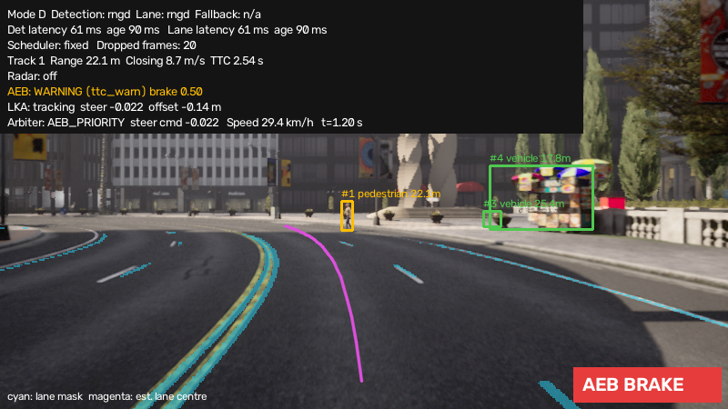
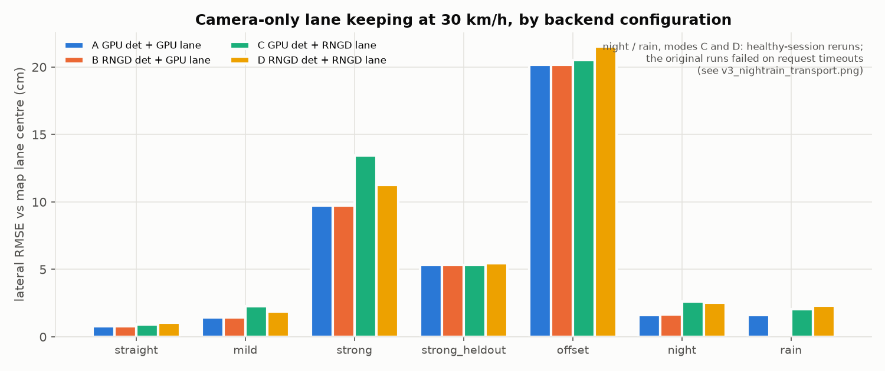
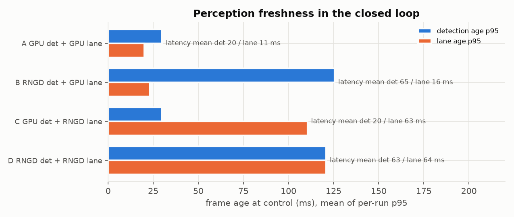
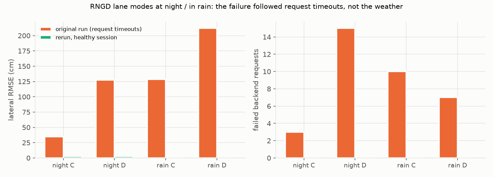

# Edge-NPU Autonomous Driving Perception & Control System

> CARLA closed-loop autonomous-driving research prototype using GPU and Furiosa RNGD NPU perception.

## Overview
I ported several perception models to a real NPU (Furiosa RNGD), built an asynchronous, multi-model
runtime for them, and closed the loop in CARLA. A camera feeds object detection and lane segmentation,
which in turn feed tracking, emergency braking (AEB) and lane keeping (LKA). The evaluation then measures
how system-level latency, rather than model latency alone, changes braking margins and lane keeping.

> **Simulation-based research prototype.** This is not production autonomous driving. It has no real-time
> guarantee and no functional-safety process. Zero collisions in the tested scenarios do **not** show
> general safety. Every number below comes from a recorded run in `reports/evidence/`; SHA-256 manifests
> are in `reports/v1/`, `reports/v2/` and `reports/v3/`.

| Version | Focus | Report |
|---|---|---|
| **V1** `v1.0.0-rc1` | GPU closed-loop AEB in CARLA + real-NPU validation of YOLO26n | [`reports/v1_final_report.md`](reports/v1_final_report.md) |
| **V2** `v2.0.0-rc1` | async frame-age-aware runtime, tracking + Kalman filter, robust AEB, remote NPU in the live loop | [`reports/v2_final_report.md`](reports/v2_final_report.md) |
| **V3** `v3.0.0-rc1` | multi-model NPU perception, lane segmentation, LKA, AEB + LKA arbitration, radar fusion, failure engineering | [`reports/v3_final_report.md`](reports/v3_final_report.md) |

## Key Results
Three latency terms are kept apart throughout this README:
- **Model latency** is the accelerator execution of one frame.
- **End-to-end request latency** is the client round trip, including transport.
- **Data age** is how old the perception result is when control uses it.

| Result | Value | Kind | Evidence |
|---|---|---|---|
| YOLO26n on RNGD, BF16 | **2.0 ms** mean (batch 1); recall 0.972 / precision 0.992 vs GPU FP32 | model latency | `npu_bench_bf16.json`, `gpu_vs_npu_bf16.json` |
| Same model on RTX 3060, CUDA Graph | 2.60 ms mean (eager 13.54 ms); the fair baseline reduces an apparent "6×" NPU advantage to 1.2–1.4× | model latency | `gpu_benchmark_ext.json` |
| Lane U-Net on RNGD, BF16 | **2.8 ms**; output equals GPU BF16 (IoU 0.991–0.998 vs GPU FP32 on the same input) | model latency / correctness | `v3_npu_multimodel_bench.json`, `v3_lane_correctness_*.json` |
| Multi-PE scaling, YOLO26n | 537 → 1,052 → **1,762 inferences/s** on 1 / 2 / 4 PEs (3.3×); 8 PEs are host-bound | throughput | `v2_npu_multistream2.json` |
| Multi-model NPU server | detection on `furiosa:0` + lane on `furiosa:1` from one upload: 61 ms vs 55 ms for detection alone | end-to-end (remote) | `v3_npu_multimodel_bench.json` |
| Remote transport optimisation | **203 → 60 ms** mean round trip, lossless (same detections), found by stage profiling | end-to-end | `v2_transport_profile*.json` |
| Remote NPU in the CARLA loop | 2–3 ms of compute becomes 63–65 ms per request (mean) and **121–126 ms detection age** (p95), vs 30 ms with the local GPU | end-to-end / data age | `v3_closed_loop.json` |
| Operator compatibility database | 74 recorded compile/run results, each with the compiler's own message | porting | `docs/npu_operator_compatibility.md` |
| V3 closed loop | **80 runs** (74 + 6 reruns); **36 hazard runs, 0 collisions**; 0 lane departures in healthy sessions | simulation | `v3_closed_loop*.json` |
| Lane-age tolerance | LKA holds up to +150 ms injected lane latency; at +250 ms it is unavailable 57–65 % of the time; limit about 0.25 s | data age | `v3_closed_loop.json` |
| GPU failover | NPU stall → GPU 0.54 s, crash → GPU 0.11 s, 0 frames lost (offline); handled and logged in CARLA | robustness | `v3_failure_engineering.json` |

**Unsafe or negative results** (kept visible; see [Failure Analysis](#failure-analysis)):
- **Curve + braking lead car at 50 km/h:** remote NPU staleness cuts the braking margin from 13.7 m
  (GPU) to 2.1 m.
- **Stale detections:** 20 % stale results with RNGD latency stopped the car 0.33 m from a pedestrian.
- **Radar fusion** made closing speed worse in two of three scenario types.
- **39 m-radius curve:** unneeded braking in 4 of 10 runs.
- **INT8:** no compute speed-up.

## Demo
Mode D: both models run on the RNGD, and steering comes only from camera lane perception.

| Lane mask + estimated centre, AEB braking on a curve | Pedestrian while cornering (AEB warning) | RNGD server crash → GPU failover (logged) |
|---|---|---|
|  |  |  |

**Video:** [`assets/demo/v3/demo_v3.mp4`](assets/demo/v3/demo_v3.mp4), 640×360, 5.5 MB. It has three clips
(curve + pedestrian, curve + lead braking, NPU crash failover).

**The overlay shows:**
- detection boxes and the lane mask
- the backend of each model
- per-model latency and frame age
- track range, closing speed and TTC
- AEB, LKA and arbiter states
- steering and vehicle speed

**Clip choice:** the clips are representative day scenarios. The night/rain incident is analysed below
instead of being staged.

**Earlier demos:**
- V1: [GPU AEB](assets/demo/v1_demo.mp4)
- V2: [NPU live loop](assets/demo/v2_demo_npu_live.mp4), [failover](assets/demo/v2_demo_npu_failover.mp4)

## Architecture


| Mode | Detection | Lane |
|---|---|---|
| A | GPU | GPU |
| B | RNGD | GPU |
| C | GPU | RNGD |
| D | RNGD | RNGD (one request carries both models, on separate PEs) |

**Runtime components:**
- latest-frame queues
- stale-result gates (0.3 s)
- explicit, logged GPU failover
- a `SceneState` that is the only input to AEB and LKA

**Time-dilated hardware-in-the-loop evaluation:** every frame really runs on its backend, and the
measured latency is applied in simulation time.

**Earlier architectures:** [V1](assets/diagrams/v1_architecture.png), [V2](assets/diagrams/v2_architecture.png).

## Project Evolution
### V1 — GPU Closed Loop + NPU Validation
- **Closed loop:** CARLA camera → YOLO26n on GPU → monocular range / TTC → AEB. Camera-only AEB had
  0 collisions in 30 hazard runs at 30 km/h.
- **NPU deployment:** YOLO26n was deployed on RNGD (FP32 / BF16 / W8) and validated frame by frame
  against the GPU. In the AEB replays, the NPU made the same first-brake decision as the GPU (7 of 7).
- **Fair baseline:** a CUDA Graph GPU baseline turned an apparent 6× NPU advantage into 1.2–1.4×.
- **What V1 exposed:**
  - noisy monocular closing speed
  - pedestrian collisions at 40–50 km/h
  - about 120 ms of SSH frame transport

### V2 — Async NPU Runtime + Robust AEB
- **Transport:** stage profiling cut the remote RNGD path from 203 to 60 ms, losslessly.
- **Runtime:**
  - `InferenceBackend` abstraction (GPU / RNGD / replay)
  - latest-frame queue
  - frame-age gate
  - explicit failover
- **Perception:** a SORT-style tracker with a range Kalman filter, and a path-prediction AEB state
  machine.
- **Braking:**
  - hazard collisions 0 / 18 (V1: 2 / 18, AEB off: 14 / 18)
  - collision-free from 0 to 200 ms of injected perception latency
- **Remote RNGD in the live CARLA loop:** works, but only near-real-time (frame age p95 165–212 ms).

### V3 — Multi-Model NPU Perception + LKA + Sensor Fusion
- **Perception:**
  - a lane-segmentation network designed around measured compiler limits
  - a two-PE multi-model NPU server, with request coalescing for Mode D
- **Control:** camera-only LKA (pure pursuit with latency compensation), and AEB + LKA arbitration.
- **Sensor fusion stage 1:** camera + radar.
- **Failure engineering:** fault injection, failover in the closed loop, and memory-guarded evaluation.
- **Validation:** 80 closed-loop runs (74 in the main matrix, plus 6 reruns); results in
  [Evaluation](#evaluation).

## NPU Engineering
### Model Porting
| Model | Workload | NPU status | Precision | Main issue | Resolution |
|---|---|---|---|---|---|
| YOLO26n | object detection (driving loop) | PASS, 2.0 ms | BF16 (also FP32, W8) | unfused BatchNorm not importable; head concat lowering | fuse Conv+BN; split at the raw head, decode/NMS on the host |
| Lane U-Net (2.12 M params) | lane-marking segmentation (driving loop) | PASS, 2.8 ms | BF16 | ConvTranspose, bilinear and dilated conv unsupported; pooling fails at 256×512 | exact rewrites (ConvT → 1×1 conv + PixelShuffle, bilinear → nearest + filter); 3×3 stride-2 downsampling |
| YOLO26s | larger detector | FAIL → PASS, 4.67 ms | BF16 | a lowered weight slice must fit 64 KiB | exact output-channel SplitConv, validated against the original on CPU |
| Tiny ViT (test configuration) | small Transformer classifier | PASS, 0.44–0.48 ms | BF16 | SDPA needs contiguous q/k/v | `.contiguous()` before attention |
| MobileNetV3-Small | classification | PASS, 0.50 ms | BF16 | none | none |
| ResNet18 | classification backbone | **FAIL** | BF16 | 64 KiB limit on 512→512 / 512→256 convs; an output split is not enough | open: needs an input-channel split with a summed result |
| LR-ASPP MobileNetV3 | segmentation candidate | **FAIL** | BF16 | backend scheduling error (`Inconsistent tensor group offsets`) after rewrites | not pursued; replaced by the U-Net |

Evidence per row: [`docs/npu_model_portfolio.md`](docs/npu_model_portfolio.md).

### Operator Compatibility
- **Database:** 74 generated compile/run rows with the compiler's messages:
  [`docs/npu_operator_compatibility.md`](docs/npu_operator_compatibility.md).
- **Exact graph rewrites:** six, each validated against the original op on CPU (BN folding, bilinear ×2,
  ConvTranspose, dilated conv, split conv, contiguous attention).
- **Failure classes:** [`docs/npu_graph_lowering_notes.md`](docs/npu_graph_lowering_notes.md).

### Precision / Quantization
- **BF16** is the deployed precision.
  - On the same input, BF16 lane masks agree with FP32 at IoU 0.991–0.998.
  - RNGD output matches GPU BF16.
- **W8 is weight-only:** weights are stored as int8 and cast to BF16 inside the graph.
  - Weights shrink from 4.82 MB (BF16) to 2.44 MB.
  - It is *slower* (2.35 vs 2.00 ms).
  - Recall drops to 0.957.
- **True INT8 compute (W8A8):** blocked on `furiosa-torch` 2026.4.0. Compiler probes showed that int8
  convolution wraps modulo 256 and that the int32-accumulating convolution is not supported. Details:
  [`docs/quantization_limitations.md`](docs/quantization_limitations.md).

### Multi-Model Scheduling
- **Offline, on the host:** separate PEs per model keep detection at 400 Hz under stress. Two workers on
  one PE are worse than sequential execution, and strict priority starves the lane model.
- **Coalescing for Mode D:** a dispatcher merges pending detection and lane requests into one upload.
  It replaced a lane-request aliasing bug that starved the lane model.
- **In the closed loop:** transport dominates, so every strategy gives the same driving outcome.
  Adaptive priority cuts dropped frames from 170 to 21 and queue delay from 15 to 3 ms. Sharing one PE
  adds about 6–8 ms (p95).

### Runtime Failover
- **States:** PRIMARY / FALLBACK / DEGRADED, and every switch is logged.
- **Offline:** RNGD stall → GPU in 0.54 s, crash → GPU in 0.11 s, 0 frames lost.
- **In CARLA:** after a stall the runtime switched back to RNGD. After a server crash it did not switch
  back within the 12 s run.
- **Latency accounting:** the fallback latency includes the failed NPU wait. Leaving it out was a bug,
  found and fixed in V3.

### Transport Bottlenecks
- **Compute is not the bottleneck:** NPU compute is 2–3 ms, while the SSH round trip to the shared
  remote host is 60 ms or more.
- **What fixed it** (stage profiling, 203 → 60 ms, lossless):
  - send only the letterbox content
  - pin the remote threads
  - add an exact pre-filter
  - use SSH compression

  JPEG would reach about 30 ms, but it is lossy: recall drops to 0.89–0.91, so it was not used.
- **Shared-host and network variance:** this remains the main risk. In the loop, request p95 was
  92–103 ms, and request timeouts under host memory pressure caused the night/rain incident.

## Autonomous Driving
### Object Detection
- **Model:** YOLO26n, 640×640 letterbox.
- **Post-processing:** the same host decode/NMS on both backends, so GPU and RNGD outputs are compared
  like for like.
- **Range:** monocular, from flat-ground geometry of the box bottom (V1); range and range rate are then
  filtered by the tracker (V2).

### Lane Segmentation
- **Model:** a U-Net designed for the RNGD compiler and trained on CARLA data.
- **Accuracy:** IoU 0.727 on a held-out map (Town03, GPU FP32).
  - On 150 upsampled held-out frames: GPU FP32 0.688 vs deployed RNGD path 0.664.
  - Most of that gap comes from the double resize in the NPU client, not BF16.
- **Geometry:** masks are projected to the ground and fitted with quadratic boundaries, which give
  lateral offset, heading and curvature ([`docs/v3_perception_control.md`](docs/v3_perception_control.md)).

### Tracking
- **Tracker:** SORT-style, with a range Kalman filter and a lateral filter.
- **Ego-motion:** yaw-rate compensation of the lateral velocity.
- **Range rate:** filtering cut the closing-speed MAE from 1.51 to 1.27 m/s offline
  ([`docs/v2_tracking.md`](docs/v2_tracking.md), [`docs/v2_range_rate_filtering.md`](docs/v2_range_rate_filtering.md)).

### Radar Fusion
- **Design:** a CARLA front radar refines tracks that the camera created, with NIS-gated scalar Kalman
  updates. Radar never creates tracks.
- **Result: mixed** (see [Failure Analysis](#failure-analysis)).

### AEB
- **Logic:** a path-prediction state machine (WARNING / BRAKE) working on a path-relative corridor, so
  in-lane obstacles on curves are not ignored.
- **Inputs:** TTC and gap come from tracked range and range rate in `SceneState`.

### LKA
- **Controller:** pure pursuit (look-ahead 0.8 s × v), compensated for lane-data age with odometry.
- **Safety:** a 0.5 s lane timeout makes LKA unavailable rather than steering on stale geometry.
- **Arbitration:** braking has precedence. Throttle is 0 by construction, and steering is clamped to
  ±0.1 while braking. There is no evasive steering.

## Evaluation
**V3: 80 closed-loop runs** (CARLA 0.9.16, time-dilated HIL). They comprise:
- 24 lane-keeping runs: modes A–D × 6 routes
- a focused matrix of 50: combined AEB + LKA on curves, radar pairs, scheduling, faults, and a lane-age
  sweep
- 6 reruns: night/rain in a healthy session, and stale injection after a simulator fix

All tables: [`reports/v3_closed_loop_tables.md`](reports/v3_closed_loop_tables.md).

**Lane keeping at 30 km/h** (lateral RMSE against the map lane centre; 0 departures in healthy runs):

| Route | A: GPU lane | C / D: RNGD lane |
|---|---|---|
| straight / mild curve (R 147 m) | 0.8 / 1.4 cm | 0.9–1.0 / 1.9–2.3 cm |
| sharp curve (R 39 m) / held-out Town03 | 9.7 / 5.3 cm | 11–13 / 5.3–5.5 cm |
| night / rain | 1.6 / 1.6 cm | 2.5–2.6 / 2.0–2.3 cm (healthy rerun) |

**Hazards and combined behaviour:**
- **Hazard runs:** 36 across all backend modes and faults, with 0 collisions.
- **Curve scenarios** (16 runs, all modes): 0 collisions and 0 departures; lateral error while braking
  ≤ 12 cm.
- **Arbitration:** in all 29,618 logged braking ticks the arbiter was in an AEB mode, and |steer| was at
  most 0.10.
- **Pedestrian at 50 km/h:** minimum gap 3.44 m with GPU detection (V2: 2.27 m) and 2.11 m with both
  models on RNGD.

| Question | Measured answer |
|---|---|
| Does NPU lane segmentation work in closed loop? | Yes, in healthy sessions. With failing remote requests and no lane fallback, it did not. |
| Does multi-model NPU scheduling raise data age? | Detection age p95 is 121–126 ms remote vs 30 ms on the GPU; the second model adds about 6 ms. |
| Does radar improve closing speed? | Lead vehicle at 50 km/h: yes (0.40 → 0.24 m/s; gap 5.5 → 10.4 m). Pedestrian at 30 km/h and curve obstacle: worse. |
| Is LKA stable during AEB? | Yes: lateral error while braking ≤ 12 cm, steering ≤ 0.10, no departures. |
| Is the control budget met? | Lane: yes (limit about 0.25 s). Braking at 50 km/h: the margin drops by up to 11.6 m. |





## Failure Analysis
### INT8 compute limitation
- **W8 is weight-only.** It halves weight storage (4.82 → 2.44 MB), but every multiply-accumulate
  still runs in BF16.
- **No speed-up:** W8 is slower than BF16 (2.35 vs 2.00 ms), and recall drops from 0.972 to 0.957.
- **True INT8 compute was blocked by the tested SDK:**
  - int8 convolution wraps modulo 256
  - the int32-accumulating convolution is reported as not supported
  - activation quantization is unavailable

  This was shown by compiler probes, not assumed. W8 is kept as a documented negative result.

### Remote transport
- **The model is fast, the system is not:** NPU inference takes 2–3 ms, but the remote round trip
  dominates.
- **Profiling helped:** it found an oversized payload, oversubscribed host threads and decode work, and
  fixing them cut 203 → 60 ms losslessly.
- **The cost remains:** in the loop, detection data age (p95) is 121–126 ms vs 30 ms on the GPU, and
  shared-host and network variance remains. The fix is co-locating the NPU with the camera, not a faster
  model.

### Lane NPU incident (night/rain)
1. **Symptom:** RNGD lane modes (C/D) left the lane in night and rain. This looked like a BF16 precision
   problem on dark, low-contrast frames.
2. **Hypothesis tested:** a same-frame GPU vs NPU validation on 440 frames (240 dataset + 200 real
   driving frames).
   - RNGD equals GPU BF16 (IoU 0.991–0.998 vs FP32).
   - Night and rain were no worse than day.

   **Precision was disproved.**
3. **Root cause:** the four failing runs were the last before the host ran low on memory. Their remote
   requests timed out at 1 s (detection requests too), and Modes C/D have no lane fallback, so LKA lost
   its input.
4. **Confirmation:** the same configurations rerun in a healthy session had 0 departures and 2.0–2.6 cm
   RMSE.
5. **Smaller real defect:** the NPU client resizes twice (letterbox 640×360, then 512×256). That costs
   2–6 % mask IoU and about 2 cm of offset error in rain. It is documented, not yet fixed.



### Other unsafe or open results
- **Remote staleness costs braking margin:** on a curve with a braking lead car at 50 km/h, the minimum
  gap is 13.7 m with the GPU and 2.1 m with RNGD + RNGD.
- **Stale detections:**
  - With 20 % stale results and RNGD latency (Mode B), the car stopped 0.33 m from a crossing pedestrian.
  - This appeared only after fixing a simulator bug that had silently disabled stale injection.
- **Radar fusion stage 1 is mixed:**
  - Closing-speed error gets worse for a pedestrian at 30 km/h (0.55 → 1.14 m/s) and for a curve obstacle
    (0.34 → 2.85 m/s).
  - The likely cause is association with other radar returns; this is not isolated.
- **Unneeded braking:**
  - On a 39 m-radius curve with no hazard, in 4 of 10 runs, plus early braking for a kerbside pedestrian.
  - The braking target was outside ±2 m laterally. The root cause is open, because the target state was
    not logged.
- **Missing NPU lane fallback:** Modes C/D have no GPU lane fallback by default.
- **Bugs found by questioning suspicious numbers** (each fixed, with a unit test):
  - Mode D lane-request aliasing
  - failover latency hiding the failed wait
  - stale injection erased by measured-latency simulation

## Known Limitations
- **Not real-time:** the remote RNGD loop is near-real-time; SSH transport is the bottleneck.
- **No default lane fallback** in Modes C/D.
- **Open perception/control issues:**
  - radar fusion is not a general improvement
  - unneeded braking on tight curves
  - a 0.30 m lane-geometry offset error on a 39 m-radius curve
- **Porting gaps:** ResNet18 and LR-ASPP do not compile, and there is no INT8 compute.
- **Evaluation scope:**
  - one run per cell, so no confidence intervals
  - developed and evaluated on the same scenario family
  - no lane keeping at 50 km/h
  - no LiDAR, no traffic lights
  - CARLA only; no real-vehicle validation
- **Resources:** 16 GB RAM is tight for CARLA plus the tooling. The V3 matrix runs in phases with a
  free-memory guard.

## Repository Structure
```text
src/npu_ad/
  perception/   YOLO raw-head wrapper, lane U-Net + geometry, tracker, filters, radar fusion
  runtime/      inference backends (GPU / RNGD / replay), async pipeline, multi-model client, failover
  control/      AEB (V1, V2), LKA, arbiter
  simulation/   CARLA session and sensors, exclusive server lock, geometry, traffic actors
  npu/          exact graph rewrites for the RNGD compiler
  evaluation/   metrics
  viz/          demo overlays
  scene.py      SceneState: the only input to AEB and LKA
remote/         scripts that run on the NPU host (compile, benchmark, multi-model server, probes)
scripts/        experiments, matrix runners, analysis, demo, diagram and manifest generators
tests/          pytest suite (fake NPU server; the live CARLA test is opt-in)
configs/        scenario, latency and route configuration
code/           original step-by-step CARLA learning scripts (01–09)
docs/           design notes, NPU porting, interview Q&A, resume summaries
reports/        final reports V1–V3, evidence JSON, manifests, generated tables, sanitization log
  agent_runs/   raw development logs (task tables, failure ledger) from AI-assisted development
assets/         demo videos and key frames, plots, architecture diagrams
```

## Reproduction
### Local CARLA / GPU
**Requirements:**
- Windows (developed on Windows 11)
- Python 3.12
- an NVIDIA GPU (developed on an RTX 3060 12 GB)
- CARLA 0.9.16 and its Python wheel
- the packages pinned in `requirements-lock-windows.txt` (its `carla` entry points to the wheel inside a
  local CARLA install; adjust that path)

**Not in the repository:** model weights (`models/*.pt`; SHA-256 values are in the reports), datasets
and local outputs.

```powershell
python -m venv .venv; .\.venv\Scripts\pip install -r requirements-lock-windows.txt
$env:PYTHONPATH = "src;scripts"
.\.venv\Scripts\python.exe -m pytest -q        # 80 passed, 1 skipped with models/yolo26n.pt present (79 + 2 skipped without it)

<CARLA_ROOT>\CarlaUE4.exe -RenderOffScreen -carla-rpc-port=2000      # separately; one client at a time
$env:NPU_AD_LIVE_CARLA = "1"; .\.venv\Scripts\python.exe -m pytest -q  # with the server running
.\.venv\Scripts\python.exe scripts\run_v1_demo.py                     # V1 demo (GPU)
.\.venv\Scripts\python.exe scripts\v3_analyze.py                      # V3 tables + plots from evidence
```

### Furiosa NPU
**Requirements:**
- access to Furiosa RNGD hardware
- the Furiosa SDK (`furiosa-torch` 2026.4.0 was used), on a Linux host

The NPU host here was a shared remote machine. It is reached through an SSH alias, and no host name, user
or key is stored in the repository. Example `~/.ssh/config`:

```text
Host furiosa-npu
    HostName <REMOTE_NPU_HOST>
    User <REMOTE_USER>
```

```powershell
.\.venv\Scripts\python.exe scripts\npu_remote.py sync          # copies remote/ + required src/ to ~/npu_auto_driving_p2
.\.venv\Scripts\python.exe scripts\run_v3_demo.py              # V3 demo (Modes B/D need RNGD)
bash scripts/v3_matrix_focused.sh lk_strong comb_a comb_b       # V3 matrix phases (see the script)
.\.venv\Scripts\python.exe scripts\v3_lane_correctness.py      # same-frame GPU vs RNGD lane test
```

Earlier reproduction steps are in the V1 and V2 reports.

## Future Work
1. **Co-located NPU runtime:** zero-copy capture, a C++ client and no SSH. Target detection age below
   40 ms.
2. **Lane failover by default** for RNGD lane modes, and the same preprocessing on both paths (remove
   the double resize).
3. **AEB target logging,** then fix tight-curve path extrapolation and radar association.
4. **Porting:** ResNet18 through an input-channel split; activation quantization once the SDK supports
   it.
5. **Evaluation:** repeated runs with confidence intervals, held-out scenarios, lane keeping at 50 km/h,
   and LiDAR as fusion stage 2.
