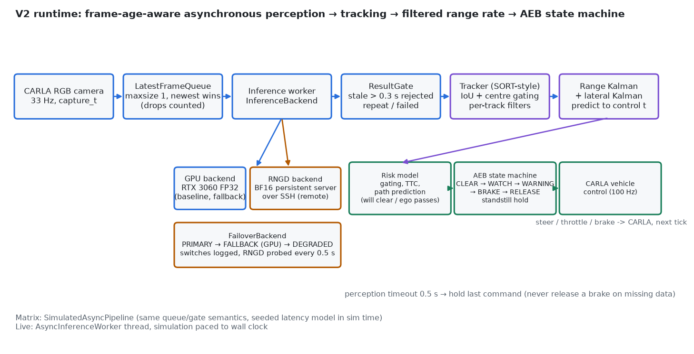

# V2 architecture



**Question.** How should an NPU-based perception runtime be designed so that low model latency
becomes low and predictable control latency?

**What V2 changes against V1:**

| Concern | V1 | V2 |
|---|---|---|
| Inference access | `GpuDetector` called directly in the loop | `InferenceBackend` interface: GPU, remote RNGD, replay, mock; failover wrapper |
| NPU in the system | offline benchmark only | persistent remote server; replay (Mode B) and live loop (Mode C) through the same interface |
| Timing model | measured latency applied as an actuation delay, perception at 100 Hz | latest-frame queue + worker: latency also limits the perception rate; frame age per result |
| Stale data | not represented | results older than 0.3 s rejected; 0.5 s without data → degraded hold |
| Target selection | single closest in-path box per frame | multi-object tracker with identities, coasting, per-track filters |
| Range rate | 0.3 s least-squares slope | per-track Kalman with range-dependent noise and outlier gate |
| Lateral motion | not estimated | per-track lateral Kalman; path prediction (will clear / ego passes) |
| AEB logic | thresholds + permanent latch | gated risk model + CLEAR/WATCH/WARNING/BRAKE/RELEASE, standstill hold, release with TTC margin |
| Transport | 121 ms raw frame over SSH (measured, not used in a loop) | profiled stage by stage; 60 ms lossless (content-only, pinned threads, pre-filter, SSH compression) |

**What stays the same:**
- the V1 GPU path, kept as baseline and fallback
- the detector, thresholds (TTC 1.6 / 2.6 s, partial brake 0.5) and camera
- the CARLA map, spawn, settle phase and server lock

## Module map
```text
src/npu_ad/runtime/backends.py    InferenceResult, GPU / Furiosa remote / replay / mock backends, transport client
src/npu_ad/runtime/pipeline.py    LatestFrameQueue, AsyncInferenceWorker, SimulatedAsyncPipeline, LatencyModel, ResultGate
src/npu_ad/runtime/fallback.py    FailoverBackend (PRIMARY/FALLBACK/DEGRADED), HealthMonitor
src/npu_ad/perception/tracker.py  MultiObjectTracker, Kalman1D
src/npu_ad/perception/filters.py  FiniteDifference, WindowLsq, AlphaBeta, RangeKalman
src/npu_ad/control/aeb_v2.py      risk model, path prediction, AebStateMachine
src/npu_ad/viz/overlay_v2.py      runtime overlay for the demo
remote/npu_server.py              persistent BF16 inference server on the RNGD host
remote/port_lab.py, multistream.py NPU porting lab and multi-PE probe
scripts/v2_*.py                   experiments (transport, filters, latency samples, replay, matrix, live loop, resolution)
```

**Detailed docs:**
- runtime: `v2_npu_runtime.md`
- async pipeline: `v2_async_pipeline.md`
- transport and profiling: `v2_npu_transport.md`
- tracking: `v2_tracking.md`
- filtering: `v2_range_rate_filtering.md`
- AEB: `v2_aeb_controller.md`
- NPU engineering: `v2_operator_compatibility.md`, `npu_operator_compatibility.md`
- results: `v2_benchmark.md`, `../reports/v2_final_report.md`
