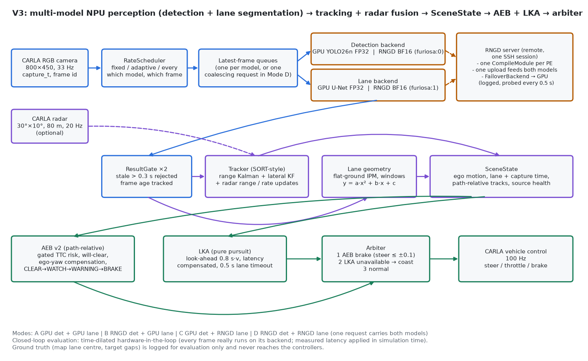

# V3 final report: multi-model NPU perception, lane keeping, AEB + LKA, radar fusion

**Status: COMPLETE (release candidate, local only), with documented safety failures.**
- Branch `feature/v3-multimodel-npu`, from `v2.0.0-rc1`. Nothing pushed.
- Simulation-only research prototype: not production autonomous driving, no real-time guarantee.

Evidence:
- **Run data:** `reports/evidence/`.
- **Generated tables:** `reports/v3_closed_loop_tables.md`, written by `scripts/v3_analyze.py` from
  `v3_closed_loop.json`.
- **Manifest:** `reports/v3/evidence_manifest.json` (SHA-256).

## 1. Scope
V3 adds the following on top of V2's single-model async runtime:
- a second perception model (lane segmentation) on the NPU
- a multi-model runtime with scheduling
- camera-only lane keeping (LKA)
- AEB that works on curves
- AEB/LKA arbitration
- radar fusion, stage 1
- a scene state that the controllers read

It answers whether the remote RNGD multi-model path keeps perception fresh enough for closed-loop
control, and where it does not.

## 2. Architecture


**Backend modes:**

| Mode | Detection | Lane |
|---|---|---|
| A | GPU | GPU |
| B | RNGD | GPU |
| C | GPU | RNGD |
| D | RNGD | RNGD (one request per frame carries both models, separate PEs) |

**Evaluation method: time-dilated hardware-in-the-loop.**
- Every camera frame really runs on its backend: local GPU, or the remote RNGD server over SSH.
- The measured call latency is applied in simulation time.
- CARLA ticks synchronously at 100 Hz; the camera runs at 33 Hz.
- Ground truth (map lane centre, target gaps) is logged for evaluation only.

## 3. NPU models
See `docs/npu_model_portfolio.md` (table: model, task, compile, runtime, main issue, workaround).
- **YOLO26n:** BF16, 2.0 ms.
- **Lane U-Net:** BF16, 2.8 ms; designed around measured compiler limits.
- **YOLO26s:** runs after an exact SplitConv rewrite (4.67 ms).
- **MobileNetV3-S and a tiny ViT:** run as-is.
- **Do not run:** LR-ASPP (backend scheduling error) and ResNet18 (64 KiB weight-slice limit on
  large-input-channel convolutions).
- **Precision:** INT8 compute is unavailable on this SDK path; W8 is weight-only.

## 4. Operator compatibility
`docs/npu_operator_compatibility.md` has 74 generated rows with the compiler's own messages. Six exact
graph rewrites are validated on the CPU against the original operators: BN folding, bilinear ×2,
ConvTranspose, dilated conv, split conv, contiguous attention. `docs/npu_graph_lowering_notes.md`
explains the failure classes.

## 5. Multi-model runtime
`RngdMultiModelClient` keeps one persistent SSH session to `remote/npu_server_v3.py`, which runs one
compiled model per PE: detection on `furiosa:0`, lane on `furiosa:1`.

| Measurement | Detection only | Detection + lane |
|---|---|---|
| Offline benchmark, mean / p95 | 55.0 / 64.2 ms | 61.2 / 64.3 ms |
| Inside the closed loop (healthy runs), mean / p95 | 63–65 / 92–103 ms | — |

**Fixed during V3:**
- **Mode D lane starvation.** Choosing the operation at capture time aliased with the ~53 ms request
  period, so lane results were lost. Now fixed by `CoalescingDispatcher`, with a unit test.
- **Hidden failover delay.** The failover result's latency excluded the failed primary attempt. Fixed,
  with a unit test.
- **Ineffective stale injection.** Measured-latency simulation dropped the injected stale delay. Fixed,
  with a unit test.

## 6. Scheduling
- **Offline, on the host** (`v3_npu_multimodel.json`): separate PEs are best under a 400 Hz stress. Two
  workers on one PE are worse than sequential execution.
- **In the closed loop** (Mode D, curve + lead braking and pedestrian while cornering; 8 runs):

| Strategy | Detection age p95 | Dropped frames | Queue delay | Outcome |
|---|---|---|---|---|
| Both models every frame, separate PEs | 80–100 ms | 162–170 | 15 ms | no collision |
| Both every frame, **same PE** | 90–100 ms (+6–8 ms latency p95) | 175–178 | 14–15 ms | no collision |
| Rate-decoupled (lane due every 2nd frame) | 90–100 ms | 157–170 | 15–17 ms | no collision |
| **Adaptive priority** | 80–90 ms | **21–42** | **3–5 ms** | no collision |

**Conclusions:**
- In the loop, the transport (about 60 ms per request) dominates. Every strategy gives the same
  driving outcome, within 0.5 m minimum gap.
- Adaptive priority offers fewer frames (detection every 2nd frame without a hazard). Far fewer frames
  are dropped and queue delay falls to 3–5 ms, at the same freshness and outcome. The number of requests
  stays about the same (204 vs 229, 170 vs 171), because the transport is the bottleneck.
- Rate decoupling has almost no effect in Mode D. A pending lane request is almost always due by the
  time the previous request returns, so the dispatcher sends both models.
- "Sequential" scheduling is represented by both models on one PE. True single-worker sequential
  execution was measured only offline.

## 7. Lane segmentation
- **Model:** trained on 2,700 CARLA frames. Validation IoU 0.817; held-out Town03 IoU 0.727 (GPU).
- **Same-frame correctness** (`scripts/v3_lane_correctness.py`). Six paths, the same weights, the same
  frames:
  - 240 lane-set frames across 8 map × weather groups, and 200 real 800×450 closed-loop frames
  - night, rain, sunset and day; mild and sharp curves

| Comparison (IoU vs GPU FP32, same frames) | Day / sunset | Night | Rain |
|---|---|---|---|
| GPU BF16 (NPU-exported graph), same preprocessing | 0.990–0.998 | 0.997–0.998 | 0.991–0.995 |
| **RNGD BF16, same preprocessing** (`rngd_directprep`) | 0.991–0.998 | 0.997–0.998 | 0.991–0.995 |
| GPU FP32 with the NPU client's preprocessing | 0.936–0.972 | 0.943–0.980 | 0.952–0.966 |
| **RNGD live path** (as deployed) | 0.937–0.972 | 0.943–0.980 | 0.947–0.966 |

**Result:**
- RNGD numerics equal GPU BF16.
- The remaining 2–6 % difference comes from preprocessing. The NPU client sends the letterboxed
  640×360 content, which the server resizes to 512×256 a second time.
- Lane geometry was valid on 100 % of night and rain frames for every path.
- On real frames, the lane offset error against ground truth was:

| Path | Night | Rain |
|---|---|---|
| GPU | 3.7 cm | 8.1 cm |
| RNGD live | 3.8 cm | 10.4 cm |

## 8. LKA
Pure pursuit with latency compensation (look-ahead 0.8 s·v, clamped to 6–20 m) and a 0.5 s lane
timeout. Steering comes only from camera lane perception.

**Lane keeping at 30 km/h** (lateral error vs the map lane centre; 0 departures in every healthy run):

| Route | A (GPU lane) | C / D (RNGD lane) |
|---|---|---|
| straight | 0.8 cm | 0.9 / 1.0 cm |
| mild curve, R 147 m | 1.4 cm | 2.3 / 1.9 cm |
| sharp curve, R 39 m | 9.7 cm | 13.4 / 11.3 cm |
| sharp curve, held-out Town03 | 5.3 cm | 5.3 / 5.5 cm |
| night (healthy rerun for C/D) | 1.6 cm | 2.6 / 2.5 cm |
| rain (healthy rerun for C/D) | 1.6 cm | 2.0 / 2.3 cm |
| 0.8 m initial offset | recovered, 20 cm RMSE including the transient | 21 / 22 cm |

**How old can lane perception be?** Mode A with injected lane latency:

| Injected lane latency | Lane age p95 | Effect |
|---|---|---|
| up to 150 ms | up to 226 ms | lane keeping holds: lateral RMSE 4 cm on the mild curve and at night, 10 cm on the sharp curve |
| 250 ms | 290–300 ms | the 0.3 s stale gate rejects about half the results: LKA unavailable 57–65 %, steering rate RMS 0.6–1.1 /s (vs 0.06–0.33), RMSE 10–17 cm |

There were no departures within 12 s at 30 km/h. The practical lane-age limit of this controller is
therefore about **0.25 s**, set by the stale gate. The remote RNGD lane age (p95 111–121 ms in healthy
runs) is inside it.

**Weakness:** on the 39 m-radius curve the lane-estimate offset error is about 0.30 m on every backend.
The flat-ground quadratic geometry often sees only one boundary.

## 9. Radar fusion (stage 1)
Mode A, camera only vs camera + radar, same scenario and speed. Primary track vs ground truth.

| Scenario | Closing-speed MAE, camera → + radar | Range MAE | Min gap |
|---|---|---|---|
| lead vehicle braking, 30 km/h | 0.33 → 0.36 m/s | 0.25 → 0.22 m | 9.6 → 8.9 m |
| **lead vehicle braking, 50 km/h** | **0.40 → 0.24 m/s** | 0.31 → 0.13 m | **5.5 → 10.4 m** |
| pedestrian crossing, 30 km/h | 0.55 → **1.14** m/s (worse) | 0.29 → 0.38 m | 11.9 → 10.1 m |
| pedestrian crossing, 50 km/h | 0.69 → 0.58 m/s | 0.07 → 0.06 m | 3.44 → 3.44 m |
| **curve + static obstacle** | 0.34 → **2.85** m/s (worse) | 0.75 → 0.51 m | 15.5 → 15.1 m |

**Conclusion: no general improvement.**
- **Where radar helps:** a vehicle in the lane at 50 km/h. The minimum gap almost doubles.
- **Where it hurts closing speed:** the pedestrian at 30 km/h and the obstacle on a curve.
- **Plausible cause, not isolated:** association picks returns from other surfaces inside the gate
  (roadside structures on the curve, the road around a small pedestrian). The measured
  radial-velocity projection then disagrees with the track.
- **Collisions:** none with or without radar.
- **Status:** radar fusion stays experimental.

## 10. AEB (path-relative, ego-yaw compensated)
**Hazard scenarios: 36 runs, 0 collisions** (all modes, 30–50 km/h, on curves and straight roads, with
faults). Minimum gaps:

| Case | A (GPU) | D (RNGD + RNGD) |
|---|---|---|
| Pedestrian crossing, 50 km/h | 3.44 m (V2: 2.27 m; V1: side collision) | 2.11 m |
| Curve + lead vehicle braking, 50 km/h | 13.7 m | **2.1 m** |
| Curve + static obstacle, 50 km/h | 17.5 m | 12.4 m |

The ~90 ms extra detection age of the remote NPU costs up to 11.6 m of margin.

**Arbitration check (all V3 logs):**
- 29,618 braking ticks, all in `AEB_PRIORITY` or `AEB_AND_LKA_DEGRADED`.
- |steer| ≤ 0.10 while braking.
- Maximum lateral error while braking ≤ 0.12 m; no departure while braking.

**Fault: 20 % stale detection results** (Mode B, with the fixed injection): the pedestrian crossing at
30 km/h ended **0.33 m** from the pedestrian (no fault: 11.9 m). Each stale result also blocks the single
in-flight request for 0.4 s, so only 54 fresh detections arrived.

**Unneeded braking:**
- **Sharp curve (R 39 m), no hazard:** 4 of 10 runs (Mode C; Mode A with 50, 150 and 250 ms lane delay).
  The track that triggered it was outside ±2 m of the predicted path, so the brake came from
  path-entry prediction, not an in-path object. The responsible track's state was not logged, so the
  root cause is open.
- **`ped_cornering`:** AEB brakes about 1.2 s after start for a pedestrian still standing at the kerb
  21 m ahead. The quadratic path extrapolation on the tight curve brings the kerb into the corridor.

## 11. Closed-loop evaluation (design)
**Runs:**
- **Main matrix, 74 runs:** the first 24 lane-keeping runs (modes A–D on 6 routes) plus a focused
  matrix of 50 runs (`scripts/v3_matrix_focused.sh`).
- **Separate reruns, 6 runs:**
  - night/rain C/D in a healthy session
  - `det_stale20` with the corrected injection

**Why 50 focused runs instead of the planned ~95:**
- CARLA was stopped twice by system memory pressure, so the remaining runs had to fit a resource budget.
- Each run is deterministic apart from small rendering variation. V1 repeated runs agreed within
  0.03 m, so one run per cell was used and repetitions were spent on new conditions.

**What the 50 runs cover:**
- **Configurations:** all four backend modes on lane keeping and on the three combined curve scenarios.
- **Speed:** 30 km/h for everything; 50 km/h only for the high-risk cases.
- **Comparisons:** radar on matched pairs; scheduling and faults on two representative scenarios each.
- **Lane-age experiment:** a dose-response sweep.

**Not covered:**
- lane keeping at 50 km/h
- `static_obstacle`, `pedestrian_clearing` and `cyclist_crossing` in V3 (they were covered in V2)
- repeated runs per cell, so there are no confidence intervals

**Memory:** every run recorded memory before and after (`memory_before/after`), and a 10 s trace was
kept (`v3_memory_trace.csv`). Free RAM stayed between 3.7 and 6.5 GB during the focused matrix.

## 12. GPU / NPU comparison (closed loop, healthy runs)
| Mode | Detection latency mean / p95 | Lane latency mean / p95 | Detection age p95 | Lane age p95 | Hazard collisions | Lane departures |
|---|---|---|---|---|---|---|
| A GPU + GPU | 20 / 25 ms | 11 / 12 ms | 30 ms | 20 ms | 0 / 9 | 0 |
| B RNGD + GPU | 65 / 103 ms | 16 / 19 ms | 126 ms | 23 ms | 0 / 3 | 0 |
| C GPU + RNGD | 20 / 24 ms | 63 / 97 ms | 30 ms | 111 ms | 0 / 3 | 0 |
| D RNGD + RNGD | 63 / 92 ms | 64 / 93 ms | 121 ms | 121 ms | 0 / 6 | 0 |

- The NPU executes in 2–3 ms. Everything else is transport and host work.
- The control stack (tracking, geometry, AEB, LKA, arbitration) takes 1.8–3.3 ms p95.

## 13. Failure engineering
**Offline** (V3, `v3_failure_engineering.json`): stall → GPU in 0.54 s, crash → GPU in 0.11 s, 0 frames
lost.

**In the closed loop** (B+C failover: both paths use `FailoverBackend`):

| Fault | Logged switches | Result |
|---|---|---|
| NPU stall, lead vehicle braking | PRIMARY→FALLBACK→PRIMARY | 9.35 m gap |
| NPU stall, sharp curve | PRIMARY→FALLBACK→PRIMARY | 0 departures |
| NPU server crash | PRIMARY→FALLBACK on both paths | 9.62 m gap |
| Lane-model failure (1.5–3.5 s), Mode C | none (fault only) | LKA unavailable 14 %, max lateral 0.36 m, 4.2 m gap |

- **Crash recovery:** the crashed server did **not** return to RNGD within the 12 s run. A new session
  needs about 9.6 s (offline measurement).
- **Fallback latency** now includes the failed-attempt wait.

## 14. Night/rain failure analysis
**Observed:** in the first 24 runs, Modes C/D failed at night and in rain:
- 1–4 lane departures
- two guardrail contacts
- LKA unavailable 42–100 %

**Investigated hypotheses:**

| Hypothesis | Test | Result |
|---|---|---|
| A: BF16 numerics | same frames on RNGD vs GPU BF16 vs GPU FP32 | **rejected**: RNGD = GPU BF16; BF16 costs < 1 % IoU; night/rain no worse than day |
| B: transport / frame age | per-request records of the failing runs; healthy-session rerun; lane-delay sweep | **confirmed as the cause** (below) |
| C: preprocessing mismatch | GPU FP32 with the NPU client preprocessing | **real but minor**: double resize costs 2–6 % IoU and ~2 cm offset in rain; not enough to fail |
| D: scheduler starvation | Mode D request counts | **fixed**: with the fixed scheduler the lane model ran in 87–100 % of Mode D requests; lane age = detection age |

**Evidence for B:**
- The four failing runs (01:26–01:30) were the last runs before the system stopped CARLA for low memory.
- Their RNGD requests timed out at 1.0 s: night D 8 of 20 failed; rain C 11 of 13.
- The **Mode B** rain run, with RNGD detection, also had 9 of 15 detection requests time out. Its lane
  ran on the GPU, so it kept the lane.
- The masks that did arrive had 0 geometry failures.
- The same four configurations re-run in a healthy session had 0 departures and 2.0–2.6 cm RMSE.

**Real weakness exposed:** Modes C/D have no lane fallback by default. When remote requests time out,
LKA goes unavailable, the car coasts with steering decaying to zero, and it leaves the lane on a curve.
The B+C failover configuration handles this, as the stall and crash runs show.

## 15. Memory / resource limitations
- **Desktop:** 16 GB RAM, shared by CARLA (about 1–2 GB resident in this session), VS Code (about
  1.7 GB), a browser (about 1.6–1.9 GB) and the agent.
- **Two stops:** Claude Code's memory-pressure reaper stopped CARLA and the matrix twice. The first
  stop was idle; the second came after 24 runs.
- **Mitigations:**
  - a free-RAM guard before every run (stop at < 1.0 GB, results kept)
  - phases short enough to run in the foreground
  - per-run memory snapshots and a memory trace
- System settings (pagefile, drivers) were not changed.

## 16. Known limitations
1. **The remote RNGD loop is near-real-time, not real-time.** Detection age p95 is 121–126 ms vs 30 ms
   on the GPU, and the safety margin at 50 km/h shrinks by up to 11.6 m.
2. **Modes C/D need lane failover** to survive transport degradation (§14).
3. **Unneeded braking on the 39 m-radius curve** (4/10 runs), and early braking for a kerbside pedestrian
   while cornering.
4. **Radar fusion is not an improvement in general** (§9).
5. **20 % stale detection results** with RNGD latency left only 0.33 m to a pedestrian.
6. **Lane geometry on sharp curves** has a 0.30 m offset error. `road_condition` is not perceived.
7. **ResNet18 and LR-ASPP do not compile;** there is no INT8 compute.
8. **Evaluation scope:**
   - one run per cell
   - the controller was developed and evaluated on the same scenario family
   - no lane keeping at 50 km/h
   - no LiDAR and no traffic-light model

## 17. Reproduction
```powershell
$env:PYTHONPATH = "src;scripts"
.\.venv\Scripts\python.exe -m pytest -q                                  # 80 passed, 1 skipped (live opt-in)
C:\CARLA_0.9.16\CarlaUE4.exe -RenderOffScreen -carla-rpc-port=2000      # separately
bash scripts/v3_matrix_focused.sh lk_strong lane_age lane_age2 comb_a comb_b comb50 radar_cam radar_on radar_curve ped50_d sched faults faults_lane
.\.venv\Scripts\python.exe scripts\v3_capture_frames.py
.\.venv\Scripts\python.exe scripts\v3_lane_correctness.py --sources dataset --out reports\evidence\v3_lane_correctness_dataset.json
.\.venv\Scripts\python.exe scripts\v3_lane_correctness.py --sources frames --out reports\evidence\v3_lane_correctness_frames.json
.\.venv\Scripts\python.exe scripts\run_v3_demo.py
.\.venv\Scripts\python.exe scripts\v3_analyze.py ; .\.venv\Scripts\python.exe scripts\make_v3_diagram.py
.\.venv\Scripts\python.exe scripts\make_v3_manifest.py
```
- The RNGD runs use the existing `~/.ssh/config` alias `furiosa-npu`; host details are not in the repo.
- The lane weights `models/lane_unet_s3c32.pt` are not committed. They come from
  `scripts/v3_train_lane.py` on the dataset collected by `scripts/v3_collect_lane_data.py`.

## 18. Portfolio conclusions
- **Where the NPU helps.** It executes both perception models in 2–3 ms each, on separate PEs, with
  results equal to GPU BF16. The work that made this possible was porting:
  - exact graph rewrites
  - an architecture chosen from measured compiler limits
  - a split-conv workaround for YOLO26s
- **Where system latency dominates.** Remote transport turns 2–3 ms of compute into 60–100 ms of latency
  and 120 ms of perception age. Lane keeping tolerates this, because the measured limit is about 0.25 s.
  Emergency braking at 50 km/h loses up to 11.6 m of margin.
- **Where runtime behaviour matters more than numerics.** The scary night/rain result turned out to be
  request timeouts plus a missing lane fallback, not the NPU's arithmetic. Two simulation bugs (hidden
  failover wait, ineffective stale injection) were found because the numbers looked too good.
- **How this propagates to driving.** The frame-age dose-response, the radar comparison (mixed) and the
  stale-result near miss (0.33 m) are the system-level evidence. The co-located design (NPU next to the
  camera, no SSH) is the next step.
